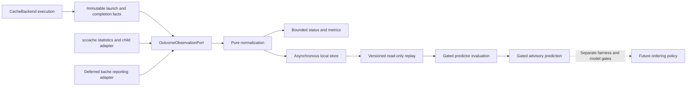

# Architectural decision record (ADR) 007: cache-outcome observation port

## Status

Proposed. This decision extends RFC 0002 with an evolutionary observation
boundary. It authorizes no runtime change or predictor experiment by itself.
[ADR 005](adr-005-cache-outcome-recording.md) remains the historical W1
decision.

## Date

2026-11-03.

## Context and problem statement

[PR #24](https://github.com/leynos/buildlimits/pull/24) merged W1 on 2026-10-31
as `f7ef2643d25f2741f7ad99999fdb6b8e3ff96769`. Its recorder, sequencer,
attribution, persistence and H2/H3 replay already exist. EP-M6 through EP-M8
are complete in the [ExecPlan](execplans/cache-hit-prediction.md); quiet-host
latency acceptance and the owner's G1 decision remain outstanding. An
abstraction change must neither discard that evidence nor release EP-M9.

The existing `StatisticsPort` returns sccache statistics text and
`ServerProcessPort` identifies and samples its server. These are useful test
seams, but are not backend-neutral observation contracts: the recorder parses
sccache 0.14.0 counters and applies sccache generation and attribution rules.
The existing `OutcomeStorePort` already isolates asynchronous persistence.

Draft [PR #43](https://github.com/leynos/buildlimits/pull/43), inspected at
`036f75f8bd70480114023d9d2cc334bef43dbf2b`, introduces `CacheBackend` for
composition, reachability and `in_scope_work`, with `DetachedCacheBackend` for
accounted drain, stop and start. Execution capabilities do not establish
observation capabilities. An in-scope cache can still lack correlated evidence.

### Number allocation and cross-branch collision

Main owns `adr-005-cache-outcome-recording.md`. PR #43 also calls its kache
record ADR 005, and labels it Accepted within that unmerged branch. Neither
publication nor that branch-local status permits replacing main's decision.
This proposal uses ADR 007 and leaves ADR 006 available for the draft kache
record. PR #43's maintainer must resolve the collision, preferably by assigning
006 and updating its references, before merge. That renumbering is not
performed or claimed here; recheck the allocation when either branch
integrates. The accepted recording decisions and their existing references
remain numbered 005.

## Decision drivers

- Preserve W1 observations, timings, failure isolation and historical evidence.
- Reuse recording, storage and evaluation without pretending caches share keys.
- Represent absence and uncertainty as data rather than invented labels.
- Keep backend interpretation testable and separate from admission accounting.
- Keep privacy, bounded work and default-off operation enforceable at
  boundaries.
- Deliver sccache extraction independently of kache adoption and prediction.

## Options considered

1. Retain a wholly sccache-specific pipeline. This preserves current behaviour,
   but makes each new backend leak into persistence, reporting and prediction.
2. Build complete pipelines for each backend. This isolates interpretation but
   duplicates retention, privacy, replay and failure handling; divergence would
   make comparisons difficult to audit.
3. Introduce one narrow observation port around the existing recorder. Chosen:
   adapters own acquisition and interpretation, shared code consumes qualified
   evidence, and existing sccache internals need no wholesale rewrite.
4. Introduce a plugin registry or copy both statistics APIs into a universal
   interface. Rejected: consumers need evidence, not arbitrary cache operations.

## Proposed direction

### Boundaries and module ownership

Add `OutcomeObservationPort` to `buildlimits/outcome_ports.py`. Put frozen,
slotted evidence values in `buildlimits/outcome_observation.py` and pure
validation/projection functions in `buildlimits/outcome_normalization.py`.
These proposed modules are the common domain boundary, not a second recorder.
The only initial concrete observer is `SccacheOutcomeObserver` in
`buildlimits/outcome_sccache.py`, composed by `supervisor_outcome_setup.py`.
Use explicit construction at that composition root, not string dispatch in
consumers. No dependency on PR #43 is needed to construct the sccache observer.

Keep the existing `outcome_recorder.py`, `outcome_recorder_types.py`,
`outcome_recorder_reading.py`, `outcome_recorder_sampling.py`,
`outcome_recorder_outputs.py` and `outcome_recorder_driver.py` as the sccache
adapter's internal pure reducer and imperative driver. Their names need not
change. `outcome_stats.py`, `outcome_parser.py`, `outcome_attribution.py`,
`outcome_gate.py`, `outcome_window.py`, `outcome_sightings.py`,
`outcome_process_sampler.py`, `outcome_sampling.py` and `outcome_queries.py`
remain sccache internals. Pure code is not automatically backend-neutral:
counter balancing and child interpretation remain backend-specific even when
free of input/output (I/O). Keep `StatisticsPort`, `ServerProcessPort`, their
tickets and failure types as internal dependencies; do not generalize their
verbs to satisfy kache.

Shared responsibilities remain in `outcome_store.py`, `outcome_store_io.py`,
`outcome_store_salt.py`, `outcome_records.py`, `outcome_record_format.py`,
`outcome_record_codec.py`, `outcome_evidence.py`, `outcome_shell_stats.py`,
`outcome_telemetry.py` and the replay entry point. Normalization checks
invariants, preserves provenance, applies retention eligibility and projects
closed reporting fields. It never infers a label from raw backend counters. The
H2 classifier and H3 parser-counter comparison in `outcome_replay.py` remain
explicitly sccache evaluators; generic coverage and eventual predictor scoring
can be shared. New backends supply evidence and an evaluation profile, not
edits to every consumer. New schema versions still require deliberate codec
changes.

`outcome_key.py`, `outcome_key_arguments.py` and `outcome_shell_keys.py` retain
the W1 fingerprint recipe unchanged. Hashing and salt handling are reusable;
argument normalization and toolchain compatibility are a versioned sccache
strategy. A future kache strategy must consume only information available
before admission. Backend-produced keys discovered after compilation are
diagnostics, never predictive inputs.

### Typed interface and lifecycle

The following proposed interface is illustrative Python. All referenced event,
result and descriptor types are immutable tagged unions or frozen dataclasses in
`outcome_observation.py`; none accepts an arbitrary dictionary payload.

```python
class OutcomeObservationPort(Protocol):
    @property
    def descriptor(self) -> ObserverDescriptor: ...

    def advance(self, event: ObservationInput) -> ObservationBatch: ...

    def poll(self, context: ObservationContext) -> ObservationBatch: ...

    def close(self, context: ObservationContext) -> ObservationBatch: ...
```

`ObserverDescriptor` contains backend identity, supported evidence-schema
identity and acquisition capabilities: `invocation_results`,
`aggregate_windows`, `child_samples` and `requires_quiet_point`. Capabilities
are fixed booleans describing collection, not promises of coverage or accuracy.
Versions discovered later are included in evidence; an unsupported version
produces unavailable evidence and disables collection as W1 already does.

`ObservationInput` is `InvocationStarted | InvocationEnded | LaunchFailed`.
Started carries a supervisor-local `(epoch, serial)` request identity, actual
execution path (`cached`, `direct`, `direct_fallback`), configured backend,
precomputed fingerprint or absence, monotonic start time and an ephemeral
acquisition context. That context is a typed union: initially the existing W1
`LaunchPayload`, including parser and child-correlation inputs. It is private
to the selected adapter and never serialized by common code. Ended carries the
same identity, clean/abnormal termination, monotonic end and UTC observation
time. Launch failure is not a cache miss. Duplicate or unknown endings retain
W1's no-op behaviour. Request identities are not crate names or cache keys.

`ObservationContext` contains explicit monotonic/UTC time and a frozen snapshot
of the existing quiet-point inputs (queue, moving work, drain, reachability,
hold, recovery and barrier facts). The sccache adapter applies `quiet_point`; a
future observer uses only the facts required by its acquisition method. `poll`
advances at most one bounded tick; `Pending` is represented by an empty batch,
not unavailable evidence. `close` is idempotent, cancels observation work and
flushes unresolved observations within the existing shutdown budget; it cannot
stop the cache or cancel a compiler. Creation, polling and closing must never
wait for subprocess completion or storage on the supervisor loop.

`ObservationBatch` contains bounded tuples of normalized evidence and closed
observation notices, plus bounded reading/span counts needed by existing
telemetry. Notices distinguish query failure, disabled collection and storage
failure from a compilation outcome. Preserve W1's query spans and reason
vocabularies through a pure sccache projection; do not export raw query text.
Batch limits inherit W1's bounded window size, with no unbounded drain loop.
The store writer remains a separate port owned by the supervisor shell.

### Minimal evidence contract

The common representation is a tagged union of `InvocationEvidence`,
`WindowEvidence` and `ObservationUnavailable`, with the following fields. This
table is normative for the proposed contract, not a new wire format.

| Field            | Type and invariant                                                                                                                                                                                                             |
| ---------------- | ------------------------------------------------------------------------------------------------------------------------------------------------------------------------------------------------------------------------------ |
| `source`         | Backend enum, exact bounded version, evidence-schema identifier/version and interpretation revision; unknown version is explicit.                                                                                              |
| `identity`       | Observer epoch plus monotonic serial for deduplication; request reference only for uniquely correlated invocation evidence. Window identity and bounded member references are separate.                                        |
| `classification` | `hit`, `miss`, `uncacheable`, `bypass`, `error` or `unknown`; never substitutes acquisition failure for compilation error.                                                                                                     |
| `quality`        | `authoritative`, `attributed`, `inferred`, `ambiguous`, `unavailable` or `insufficient`; a separate axis from classification.                                                                                                  |
| `provenance`     | Closed method: `backend_correlated`, `solo_window`, `unanimous_window`, `child_runtime`, `aggregate_only`, `execution_path` or `legacy_window`.                                                                                |
| `reason`         | Closed, versioned code; preserves refusal, compile failure, cache failure, generation change, missing baseline, unsupported schema and ambiguous correlation as distinct reasons.                                              |
| `time`           | UTC observation timestamp; monotonic start/end within one observer epoch when measured; optional non-negative finite duration plus basis `group_wall`, `backend_elapsed` or `collection_window`. Missing duration is not zero. |
| `boundary`       | Window start/end, completeness (`complete`, `partial`, `unknown`) and optional local server/session generation identity; absence never means continuity.                                                                       |
| `fingerprint`    | Optional salted request key, recipe revision, salt identity and approximate toolchain identity; compatibility is explicit, never inferred from matching digest text.                                                           |
| `detail`         | Closed typed diagnostics, initially `SccacheEvidence`: original W1 result, parser class, child sighting/count and the existing H3 refusal summary. No free-form backend JSON.                                                  |

_Table 1: Qualified evidence passed from observers to shared consumers._

An authoritative outcome requires a backend's explicit result and independently
validated unique request correlation. Solo/unanimous sccache labels are
`attributed`, never authoritative. Child/runtime classification is `inferred`
and cannot train or validate itself as ground truth. Mixed or multiply matched
observations are `unknown/ambiguous`; a missing baseline is
`unknown/insufficient`; failed acquisition is `unknown/unavailable`.
Aggregate-only windows can carry useful counts without request references.
Counts use a closed, schema-qualified outcome vocabulary with a declared
population and denominator; unknown populations prohibit coverage calculation.
No window is split among requests merely because counts happen to balance. Only
the adapter's validated attribution rule permits such a split.

For sccache, retain `hit` and `miss`; map `not_cacheable` and `declined` to
`uncacheable` with distinct detail codes; `not_compile` and `not_cached` to
`bypass` with distinct codes; `failed` and `error` to `error` with separate
compile/cache causes; `unsupported` and `unattributed` to `unknown` with their
original detail. This is a lossless projection, not permission to combine H3's
refusal counters with server results. Aggregate and invocation views of the
same observation cannot both increment a request denominator.

Direct compilation and admission-time fallback are execution-path bypasses, not
cache misses or uncacheable findings. They stay outside the cached-request
hit-rate denominator. The immediate extraction preserves W1's existing omission
of direct-launch store rows and existing path metrics. A kache-internal
fallback is distinct from admission-time fallback and needs a verified detail
mapping. Unknown kache codes, including `dup` until its meaning is validated,
remain unknown; they are not silently counted as hits.

### Compatibility, privacy and history

The immediate extraction keeps format version 1, its path, record ordering,
salted keys and byte representation unchanged. Normalize live adapter output in
memory and project losslessly to existing `OutcomeRecord` and `WindowSummary`
for the deployed writer and H2/H3 evaluators. This projection serves deployed
W1 data and readers, not private source-API compatibility. Replay maps v1 rows
to qualified evidence without rewriting the input file: backend is sccache,
recipe is W1, version comes from existing toolchain/window fields. Labelled
rows have `attributed/legacy_window` provenance because v1 does not persist
solo versus unanimous attribution. Unattributed rows cannot recover their lost
reason and must use an explicit unknown legacy reason. No generation, request
identifier, window boundary or certainty is fabricated.

A separately tested format version 2 is required before persisting evidence
that v1 cannot express, including kache. The trial implementation adds a tagged
codec for the common fields and typed details, reads v1 unchanged, and writes
v2 to a separate versioned store. It must not upgrade or overwrite the v1 file;
rollback selects the retained v1 store. Both stores together remain subject to
the existing storage budget. Unknown versions are rejected explicitly, not
coerced into W1 rows. This migration is deferred to the first actual v2 writer.

Persist no raw paths, arguments, environment values, backend cache keys or
unsalted identifying digests. Backend session/root identifiers require local
salted HMAC-SHA-256 (hash-based message authentication code) transformation;
request references become opaque local IDs and are never metric labels. Keep
raw correlation material only in bounded adapter memory. Diagnostic metadata is
allowlisted and size-limited like the record, not a privacy escape hatch.
Existing limits and rules remain in force: directory mode 0700, file mode 0600,
a single writer, a 4,096-entry append queue, a 16 KiB record ceiling, a 16 MiB
store ceiling, a 12 MiB compaction ceiling, 10,000 retained records and a
30-day age bound. Salt rotation, clock skew and corrupt/torn-tail handling keep
their current semantics.

Histories are partitioned by backend, backend version, evidence-schema and
interpretation revision, fingerprint recipe, salt identity and toolchain
identity. Cross-version reuse requires an explicit compatibility decision and
fixtures proving the relevant semantics unchanged. Missing identity means
ineligible history, not a wildcard. The W1 toolchain approximation retains its
in-place sysroot limitation. Identical hashes do not make sccache and kache
keys interchangeable. Raw hit-rate denominators and weighted time-saved figures
must not be pooled. Exact versions belong in bounded local records/reports;
metrics expose only registered backend, quality and reason enums.

### Example flow and isolation

For screen readers: the backend observer interprets evidence, shared pure code
validates it, and bounded persistence supplies replay and later prediction.
Execution and future ordering remain separate consumers of admission facts.



_Figure 1: Evidence flow; no observation edge can release an admission token._

For a solo sccache hit, the shell supplies launch/end facts. The adapter
samples children and, at a quiet point, polls statistics, verifies both
generations and attributes the balanced delta. Normalization yields
`hit/attributed` with `solo_window` provenance and the unchanged W1 key.
Publication produces exactly the old metric, status counters and v1 row. H2/H3
replay remains unchanged. A server restart instead yields unknown evidence and
the existing `generation_changed` reason, without affecting admission.

Observer exceptions, timeout, malformed data, duplicate/late events, queue
saturation and writer failure are bounded observation failures. They must not
change cache reachability, supervisor health, launch composition, token return
or admission order. The shell contains exceptions at the observation boundary;
known failures remain typed results. Unresolved or expired correlations produce
unknown evidence once; duplicate delivery cannot add training samples. With
recording off, construct no observer, worker, query, sampler or writer and do
not read the salt or store. No retry may execute on admission's behalf.

## Future kache adapter: evidence available and evidence still required

The trial scope belongs to [buildlimits #30][issue-30] and
[dev-env-rocky #339][issue-339], or their successor plans. PR #43 selects 1.2.2
and 2.0.0-rc.1 for execution checks. Source-document inspection on 2026-11-03
found the following in both tagged command references and report schemas; this
is interface evidence, not real-binary observer validation.

- `kache stats --json` provides structured summaries; `stats --full --json`
  and `report --format json` expose a full report. The JSON envelope and the
  report have distinct contracts. Report `schema_version` is 1 and is
  documented to change on breaking changes; retain the binary version as well.
- `all_events` includes result, crate name, cache key, start/end timestamps,
  elapsed, compile and overhead measurements. Results distinguish local,
  prefetch and remote hits, `dup`, miss, error, passthrough and skipped. These
  are event rows, not a documented buildlimits request-ID interface.
- `meta.session` can contain an ID or mark the selection inferred. The docs
  explicitly allow sessions to span concurrent/nearby Cargo commands and
  describe inferred grouping by overlapping activity and gaps under five
  minutes. A session, root, crate name or cache key is not one admission.
- Reports see retained, completed events only. Running work is absent, rotation
  can remove session beginnings, and repeated overlapping reports can repeat
  rows. `--since` is a selection window, not a lossless event cursor.
- `--record` and `KACHE_RECORD_SESSIONS` can write additional telemetry. Trials
  must disable these side effects. `--redact` is useful for exported reports
  but does not establish buildlimits' salted-identity privacy contract.

Primary sources: [1.2.2 commands][kache-v1-commands],
[1.2.2 schema][kache-v1-schema], [2.0.0-rc.1 commands][kache-v2-commands] and
[2.0.0-rc.1 schema][kache-v2-schema]. The two inspected report schema files
were byte-identical. This does not prove binary conformance or stability of
private event storage. The [current cache-key guide][kache-key] documents
content/toolchain/configuration inputs and path normalization for worktree
reuse; it is not a version-pinned guarantee for either trial binary.

Before implementing `KacheOutcomeObserver`, the trial owner must pin the actual
binary and report schema, capture privacy-safe real-binary fixtures, measure
collection cost and identify which reporting operation is bounded and
read-only. Test known warm hits and cold misses on the same inputs in paired
runs; repeat across worktrees, compiler versions and configuration changes.
Check whether backend keys are stable where expected, without persisting them
raw or assuming that those post-compilation keys are predictive fingerprints.

The feasibility decision must demonstrate unique correlation under concurrent
same-crate, same-key and same-root admissions, repeated builds, cancellation,
delayed completion, missing events and report overlap. Timestamp proximity is
insufficient. Document event identity, deduplication, completion watermark and
session-reset behaviour; if the interface supplies no stable identity, do not
claim exact deduplication or authoritative request labels.

The default fallback is aggregate-only, explicitly partial windows and unknown
request outcomes, with no predictor training from those windows. Controlled
isolated trials may establish attributed labels only after an independently
checked population boundary excludes unrelated activity. If higher coverage is
needed, compare a supported per-invocation export or upstream correlation field
against the cost and stability of private-log inspection. Adopt an alternative
only with pinned-source semantics, real-binary concurrency fixtures, privacy
and latency results, and an owner-recorded contract decision. Upstream
improvements are an option, not a prerequisite for aggregate observation or for
the execution backend.

## Testing and falsification strategy

The ExecPlan's EP-O1 to EP-O3 define the immediate extraction. Differential
traces must compare the merged W1 reference and extracted observer on identical
clock, salt, server-generation, statistics and lifecycle inputs. Compare query
commands, close order, event sequences, attributed records, H2/H3 replay,
status JSON/text, metric vocabulary and failure reasons. New metadata may exist
inside the port; the deployed sccache projections must be identical. A single
changed label, reordered record, changed denominator or admission effect fails
equivalence. Never regenerate expected fixtures merely to accept a difference.

Red-first finite cases and Hypothesis sequences cover mixed/solo/unanimous
windows, resets, ambiguous child matches, straddled readings, late duplicates,
overflow and shutdown. Seed an incorrect mixed-window label and duplicate row
as negative controls. Fake ports establish failure containment; real sccache
and real user-manager scenarios retain integration evidence. Quiet-host p99
limits remain 5 ms tick lengthening, 1 ms append enqueue and 2 ms child sample,
with at most 64 processes inspected per sample. The outstanding quiet-host
acceptance is not discharged by passing ordinary tests or this proposal.

## Consequences and deferred decisions

One additional boundary and explicit provenance increase type and fixture work,
but prevent backend assumptions spreading through consumers. Legacy rows remain
useful while honestly lacking provenance they never stored. Aggregate evidence
is useful for collection studies even when prediction cannot proceed.

Four decisions remain separate: collection fidelity/coverage, predictive
fingerprint adequacy, calibration/accuracy and scheduling benefit. Keep sccache
H1-H8 thresholds and G1-G5 dependencies unchanged, including ADR 005's fixed
refinements. Kache's trial owner must preregister its own population, baseline,
sample minimums, error/coverage limits, fingerprint and calibration thresholds,
latency budget and stop rules before inspecting experimental outcomes. Do not
pool calibration across backends or use improved coverage as accuracy evidence.
G1 still releases W2/EP-M9; G2 releases advisory prediction; later gates
require fairness, model/replay and shadow evidence. No prediction alters token
accounting.

Deferred decisions are the approved kache collection interface, its fingerprint
recipe, its trial thresholds and its eventual predictor eligibility. Format v2
implementation belongs with the first adapter that needs it. None blocks the
sccache extraction, existing W1 evidence collection or kache execution support.

[issue-30]: https://github.com/leynos/buildlimits/issues/30
[issue-339]: https://github.com/leynos/dev-env-rocky/issues/339
[kache-v1-commands]: https://github.com/kunobi-ninja/kache/blob/v1.2.2/docs/commands/reference.mdx
[kache-v1-schema]: https://github.com/kunobi-ninja/kache/blob/v1.2.2/docs/commands/report.schema.json
[kache-v2-commands]: https://github.com/kunobi-ninja/kache/blob/v2.0.0-rc.1/docs/commands/reference.mdx
[kache-v2-schema]: https://github.com/kunobi-ninja/kache/blob/v2.0.0-rc.1/docs/commands/report.schema.json
[kache-key]: https://ninja.kunobi.com/docs/kache/how-it-works/cache-key
