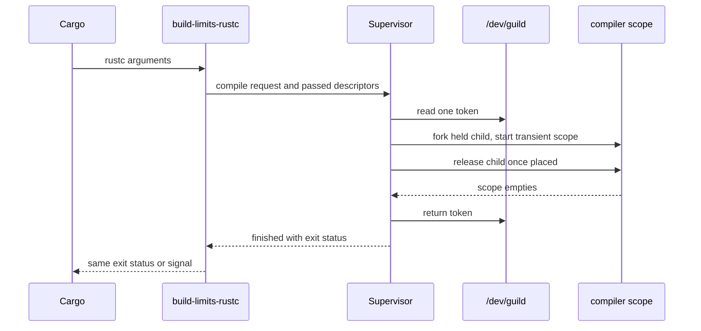

# buildlimits developer's guide

This guide is for maintainers and contributors. It is the operating manual for
working on buildlimits as it exists: the local quality gates, the supervisor's
internal interfaces and their invariants, the test suite and its helpers, and
the static-analysis exceptions the repository carries. Operator behaviour is in
the [user's guide](users-guide.md).

## 1. Normative references

These documents take precedence over this guide when they disagree with it:

- The design, the cache composition rules and the metrics schema are recorded
  upstream in dev-env-rocky: the [concurrent build limits RFC][rfc],
  [ADR 011][adr-011] on sccache under compile admission, [ADR 012][adr-012] on
  the provisioning collection and [ADR 013][adr-013] on compile-admission
  metrics.
- [ADR 001](adr-001-graceful-supervisor-restart.md) records how a supervisor
  restart cancels nothing: the graceful `SIGTERM` stop, the adapters' retry and
  the start-up stop of a live cache.
- The [repository layout](repository-layout.md) names every path and its
  responsibility.
- The [documentation style guide](documentation-style-guide.md) governs all
  prose, and the [scripting standards](scripting-standards.md) govern helper
  scripts.

The provisioning code — the `devhost.buildlimits` Ansible collection and its
Molecule scenarios — stays in dev-env-rocky. This repository owns the Python
package, its tests and the console scripts the collection installs.

## 2. Local workflow and quality gates

`make all` is the aggregate gate. It runs, in order and never in parallel,
`check-lock`, `build`, `check-fmt`, `lint`, `typecheck`, `test` and `spelling`.
Run `make markdownlint` and `make nixie` after documentation changes, and
`make audit` for the dependency vulnerability check. Narrower targets are for
investigating a specific failure; reconcile with `make all` before committing.

| Target                   | What it runs                                                                                      |
| ------------------------ | ------------------------------------------------------------------------------------------------- |
| `make check-lock`        | `uv lock --check` before the mutable dependency sync                                              |
| `make build`             | `uv sync --group dev` into `.venv`                                                                |
| `make check-fmt`         | Ruff 0.16.8 format check and mdtablefix 0.6.1 table check                                         |
| `make fmt`               | Applies Ruff formatting, import sorting and Markdown table fixes                                  |
| `make lint`              | Ruff, Interrogate (100%), Pylint and DF12 lints, Ambrleaks, Skylos, Vulture, duplication, actions |
| `make typecheck`         | `ty` 0.0.89 against the project interpreter (`--python .venv`)                                    |
| `make test`              | pytest under xdist over `tests/` and the package's doctests                                       |
| `make test-systemd-user` | The host acceptance scenarios marked `systemd_user`; see §11.4                                    |
| `make spelling`          | The shared en-GB-oxendict `typos-config-builder` gate                                             |

_Table 1: Make targets and the gates behind them._

Python sources are discovered through Git, tracked and untracked, so `git init`
must have run before the first gate. `make all` starts with `make check-lock`,
and both `build` and `build-release` depend on it. Direct builds, format and
format-check commands, and release builds therefore fail on stale project
metadata before `uv sync` or `uv run` can update the lockfile. The tool-pin
contract requires the isolated `TY_VERSION` and `RUFF_VERSION` defaults to
match their exact pins in the dev group. When bumping ty or Ruff, update its
Makefile default in the same change and fix any new diagnostics. Both tools run
in isolation; `typecheck` passes `--python .venv` so ty resolves imports from
the project environment.

### 2.1. The Python 3.14 baseline

The package requires Python 3.14. Annotations are therefore evaluated lazily
(PEP 649), and the DF12 lint `redundant-future-annotations` rejects
`from __future__ import annotations`. Two consequences matter in this codebase:

- `dataclasses.fields()` reports a field's type as the type object, not its
  source text. `config._CONVERTERS` is keyed by type for that reason.
- `inspect.signature` evaluates annotations eagerly, so a name imported only
  under `typ.TYPE_CHECKING` raises `NameError` when something introspects a
  signature. `mock.Mock(spec=SomeClass)` does exactly that; spec a mock by
  attribute names (`spec=dir(SomeClass)`) instead.

## 3. Architecture overview

The supervisor is a functional core with an imperative shell. Decisions live in
`admission`, which performs no input or output and returns a list of effects;
the shell carries those effects out.

For screen readers: the following sequence diagram shows one compile request,
from Cargo's call to the adapter through admission, scope placement and the
return of the token.

_Figure 1: The life of one admitted compile request._

Cargo runs `build-limits-rustc <compiler> <arguments...>` as `RUSTC_WRAPPER`, or
`build-limits-rustdoc <arguments...>` as `RUSTDOC`. The adapter connects to
`$XDG_RUNTIME_DIR/buildlimits/supervisor.sock`, sends a compile request
carrying its inheritable descriptors, and relays the result. The supervisor
queues the request, reads one token for it, forks a held launch child, moves
that child into a new transient scope under `buildlimits-compilers.slice`, and
releases it to execute the compiler. It returns the token once the scope has no
processes left. An adapter that finds itself inside an admitted scope runs the
compiler directly, so nested tools never ask for a second token.

## 4. Package modules

Each module owns one decision. This table is the single module inventory.

| Module                                                    | Responsibility                                                                                  |
| --------------------------------------------------------- | ----------------------------------------------------------------------------------------------- |
| `admission`, `effects`                                    | Pure state machine: queue, tokens, draining                                                     |
| `admission_state`                                         | Group lifecycle values; the identifier-free `Counts` snapshot and the `Gauges` read-only views  |
| `supervisor`                                              | Event loop that carries out admission's effects                                                 |
| `supervisor_polling`                                      | Poll cadence and ordered server, pool and cache checks; no token-release decisions              |
| `supervisor_signals`, `supervisor_shutdown`               | `SIGCHLD` self-pipe wake-up; graceful and immediate stop sequencing                             |
| `supervisor_observability`                                | Wires cached pressure and drain observers into existing owners                                  |
| `effect_dispatch`                                         | Effect handlers and their metric and health mappings                                            |
| `requesters`, `pending_request`                           | Connections, queued requests and replies; recorded request data                                 |
| `request_connections`                                     | Unrecorded sockets, received rights and refusals                                                |
| `request_validation`, `requester_metrics`                 | Pure validation over explicit context; terminal metric fields                                   |
| `request_state`                                           | Compatibility re-export of `pending_request.Pending`                                            |
| `descriptor_policy`, `descriptor_budget`                  | Pure budget arithmetic; OS sampling, retention accounting and status                            |
| `listener_pressure`                                       | Listener backpressure after accept-time exhaustion                                              |
| `groups`, `group_drain`, `group_recovery`                 | Compiler scopes; terminate, escalate and empty checks; consumed-exit recovery                   |
| `supervisor_placement`                                    | Admitted compiler placement, terminal scope outcome and stop-mode classification                |
| `launch`, `launch_setup`                                  | Held launch child and bounded setup diagnostics                                                 |
| `relocation`, `descriptors`                               | Pure descriptor placement planner; inherited-descriptor cleanup and plan execution              |
| `attributes`                                              | The caller's umask, niceness and resource limits                                                |
| `pool`                                                    | The token device, read on a thread of its own                                                   |
| `sccache`, `server_watch`                                 | The managed cache's reachability and accounting; start-up and `SERVER_DRAIN` release            |
| `cache_backend`, `cache_backends`, `cache_modes`          | The backend protocols, the composition root that turns a mode into adapters, and the vocabulary |
| `kache`, `kache_guard`, `compiler_argv`                   | The in-scope cache's composition and health; stray-process reports; leading cache-layer removal |
| `server_drain`                                            | The `SERVER_DRAIN` lifecycle, reachable only for a backend that leaves detached work            |
| `cache_recovery`, `recovery_*`                            | The recovery transaction, its barrier, reclamation, trigger and guidance                        |
| `cache_quiesce`                                           | Start-up stop of a live managed cache under the barrier, before the strict accounting           |
| `bus_properties`, `systemd`                               | Validated public-bus fallback for unit queries; transient scopes and unit jobs through `busctl` |
| `cgroups`, `startup`, `proc_trees`                        | Control-group reads, the restart barrier and diagnostic process-tree counts                     |
| `protocol`, `replies`, `framing`, `frame_payload`, `wire` | Versioned JSON frames with passed descriptors                                                   |
| `adapter`, `adapter_*`, `heartbeat`, `rustdoc`, `timing`  | Cargo-facing entry points, restart handling, signal handling, progress and rustdoc              |
| `adapter_invocation`, `adapter_retry`                     | Invocation state and deadline-preserving busy and restart retries                               |
| `tracing`, `tracing_export`, `tracing_sdk_export`         | Bounded spans, the fixed journal schema and synchronous native-journal export                   |
| `toolchain_env`                                           | Pure, filesystem-only recognition of a real toolchain compiler and its loader-path prefix       |
| `service`, `service_readiness`, `config`                  | The supervisor entry point, `READY=1` and `STATUS=` notifications, and settings                 |
| `status`, `status_client`, `status_render`, `status_cli`  | The status document, its transport, rendering and command                                       |
| `admission_readiness`                                     | Pure admission-progress classification from health, ledger counts and recovery outlook          |
| `document_cli`                                            | Shared raw `--json` parser for status and recovery document commands                            |
| `recover_client`, `recover_cli`                           | The recovery request and the `build-limits-recover` command                                     |
| `metrics*`, `journal`, `journal_native`                   | Metric vocabulary, native journal datagrams, journal queries and reports                        |
| `drain_loop`, `drain_metrics`                             | Paces drain-fault retries; observes drain progress without exit authority                       |

_Table 2: Package modules._

## 5. Admission core

`Admission` holds the queue, the admitted `Group` records and the flags
`cached` and `healthy`. Each event method updates the state and returns effects
in the order the caller must carry them out:

- `submit(request_id, *, cacheable=True)` queues a request.
- `token_arrived(token)` admits the head of the queue, or returns the token if
  nobody waits. `ServerWatch.cache_allowed` is read at that point, so a token
  that waited through a recovery is never composed with a stopped cache.
- `launch_failed`, `cancel`, `leader_exited` and `group_emptied` move a group
  through `RUNNING`, `DRAINING` and, for a cached group that ended abnormally,
  `SERVER_DRAIN`.
- `server_activity(active_compiles)` releases `SERVER_DRAIN` tokens, oldest
  first, while the server's live work fits within the tokens that remain.
- `health_failed()` refuses queued requests, terminates running groups and
  emits `Shutdown` once they have drained.
- `begin_closing()` is the graceful stop. It sets `closing`: no token is
  requested, a token already on its way is returned, no group launches and none
  is terminated, and requests that wait or arrive stay queued. Once the last
  group has emptied, `_maybe_shutdown` refuses what waits as `restarting` and
  emits `Shutdown`; a request submitted after that point is refused at once.
  `healthy` stays true throughout, so the immediate stop can still escalate.

`Admission.counts()`, `tokens_held()` and the `admitting` and `winding_down`
views come from the `Gauges` mixin in `admission_state`, which keeps the
read-only accessors out of the decision logic. `counts()` returns a frozen
`Counts` snapshot without identifiers. `tests/test_admission.py` drives the
core with a Hypothesis `RuleBasedStateMachine` against a model pool and a model
server, checking token conservation, that waiting requests hold nothing, that
tokens return only after emptiness, that server work never exceeds cached
tokens, and that nothing launches while unhealthy. The same module pins the
import boundary: `admission`, `effects` and `attributes` import no wire,
framing, reply or request module.

## 6. Supervisor shell

`Supervisor.serve` runs one `selectors` loop. Registered descriptors carry a
tag that `_dispatch` matches: `"listener"`, `"pool"`, `("conn", request_id)`,
`("errors", group_id)` and `"signals"`. Each tick escalates overdue
terminations, notices emptied scopes, polls the cache while any group is in
`SERVER_DRAIN`, checks that `/dev/guild` is still the device it opened, and
refreshes the cache's reachability.

Start-up takes a singleton lock and passes the restart barrier:
`startup.drain_slice` terminates every scope under the compilers slice and
waits for it to empty, because a crashed supervisor's tokens return to the pool
while its compilers may still run. `ServerWatch.drain_orphans` then requires
the managed cache to be accounted stopped and empty, or raises
`StartupAccountingError`, which `service.main` turns into exit status 2. Just
before that, `cache_quiesce.quiesce_live_cache` stops a cache the manager
reports live: start-up holds the singleton lock and has terminated every
compiler scope, so no admitted group can use it. It writes the barrier, queues
the stop and polls `accounted_drain` for up to 45 seconds; it never reads a
count or an idle CPU as proof, and it leaves the barrier for
`reclaim_after_accounting` to retire. A stopped cache that holds processes, a
state the manager cannot report and a stop that does not complete all still
reach `drain_orphans` or fail start-up with exit 2. On success the supervisor
opens the pool and listener, then sends `READY=1`.

Signal handlers only record intent. `SIGTERM`, which `systemctl stop` and
`restart` send, calls `request_graceful_stop()`; `SIGINT` calls
`request_stop()`. The loop honours the record before it dispatches each ready
descriptor and on every tick, so every admission change stays on the event-loop
path and a token that is ready in the same cycle as the signal is returned
rather than launched. A graceful stop calls `Admission.begin_closing()` and
sends `STATUS=` to the manager; `settle_graceful_stop` opens the recovery
transaction when only `SERVER_DRAIN` groups remain, and `settle_token_request`
returns a token the pool reader took for a request nobody will launch before
the process exits. An immediate stop still refuses the queue as `unhealthy` and
terminates the running groups; it works after a graceful stop has begun. The
exit status is 0 for both orderly stops. Children end through `SIGCHLD`
delivered by `signal.set_wakeup_fd`, and `Groups.reap` collects them with
`waitpid(WNOHANG)`. `cgroups.is_populated()` reports an empty group only for
`ENOENT` or `ENODEV`; any other read error raises, so an unreadable scope is
never taken as drained.

If `Groups.place()` fails, `supervisor_shutdown.fail_placement()` calls
`honour_stop_request()`, which handles `honour_graceful_request()` and any
pending immediate stop before applying the admission failure effects. A
graceful stop makes `Admission.launch_failed()` refuse the request as
`restarting`; the handler clears `entry.exec_error` so `Requesters.refuse()`
preserves that retry reason, and the token returns once. Without a stop, the
failure remains `launch-failed`. A pending immediate stop is consumed before
the failed placement can emit `Shutdown`: `SIGINT` refuses queued requests as
`unhealthy` and prevents adapters from retrying the failed placement.

## 7. Launching a compiler

`Groups.place` builds a `launch.LaunchSpec` and calls `launch.spawn_held`,
which forks a child that waits on a barrier pipe. The supervisor starts a
transient scope for the child's PID and waits until `/proc/PID/cgroup` names
it, because `StartTransientUnit` returns before the move. Only then does
`Groups.release` let the child continue. In the child,
`launch._become_compiler` disables the inherited wake-up descriptor, closes
unrelated inherited descriptors, applies the relocation plan within the
reachable hard `RLIMIT_NOFILE`, then applies the caller's attributes.

`relocation.relocation_plan` is pure: it validates the source-to-target
mapping, places descriptors directly, and parks at most one cycle source in the
lowest free non-target slot (`_park`). Setup failures travel through a
close-on-exec error writer as a bounded ASCII message naming the stage, errno
and descriptor counts, never argument or environment values.
`attributes.plan_attributes` refuses a request that needs higher priority or a
soft limit beyond the supervisor's hard limit; the child never falls back to
the supervisor's own attributes.

### 7.1. The cache backend seam

A cache backend is what turns the bare compiler invocation into the one the
group runs. `buildlimits.cache_backend` defines it as two protocols, and
`buildlimits.cache_backends.select` is the single place a `cache_mode` string
becomes an adapter. Every other module receives a `CacheBackend` and cannot see
the mode, so a setting the root forgets to pass is invisible everywhere else;
`tests/test_cache_backends.py` exists to catch exactly that, by driving
`select` with a non-default setting and asking the adapter what it would
actually run.

`ComposingCacheBackend` is what admission needs: `compose(argv, env)` returns
the composed vector and environment, `is_reachable()` answers health,
`fallback_notice()` words the line an uncached build sees, `name` provides the
journal and status wording, and `in_scope_work` states the capability.
`DetachedCacheBackend` adds the lifecycle only a detached backend has:
`accounted_drain`, `stop` and `start`. `DirectCache` implements the first with
no cache and `ManagedSccache` implements both; `Kache` implements only the
first, and its absence from the second is the type-level statement that an
in-scope cache has no managed service to drain or stop.

`in_scope_work` is the capability every conditional path reads. `Supervisor`
projects it once into `Admission(cache_detached=...)`, and the start-up
quiesce, the drain-token release, `SERVER_DRAIN` and the recovery transaction
are all gated on that value rather than on a mode string, so a backend that
cannot leave work behind cannot reach them. `kache_guard.guarded` reads the
same capability to decide whether the compilers' slice needs reading for stray
cache processes.

To add a backend:

1. Add the mode to `CACHE_MODES` in `buildlimits.config`, and its keys to
   `_MODE_KEYS` so that writing another backend's setting is an error.
2. Write the adapter in its own module beside `sccache.py` and `kache.py`,
   implementing `ComposingCacheBackend` and, only if its work can outlive a
   group, `DetachedCacheBackend`.
3. Add one branch to `cache_backends.select`, passing every configuration
   value the adapter reads -- the tests above will notice a dropped one.
4. If the backend can start a cache process inside a group, extend
   `kache_guard`'s executable test to recognize it; the guard is gated on the
   capability rather than the mode for that reason.
5. Record the decision in an ADR and link it from the design documents.

## 8. Wire protocol

Frames are a four-byte big-endian length followed by UTF-8 JSON with `version`
set to `1`. Descriptors travel as `SCM_RIGHTS` on the same `sendmsg` as their
frame. A frame may be at most 8 MiB and carry at most 253 descriptors. `wire`
converts decoded values without coercion, so a boolean is never accepted as an
integer.

| Direction             | Message      | Fields                                                                               |
| --------------------- | ------------ | ------------------------------------------------------------------------------------ |
| adapter → supervisor  | `compile`    | `argv`, `cwd`, `env`, `umask`, `nice`, `rlimits`, `fd_targets`, `label`, `cacheable` |
| client → supervisor   | `status`     | none                                                                                 |
| operator → supervisor | `recover`    | none                                                                                 |
| supervisor → adapter  | `queued`     | `position`                                                                           |
| supervisor → adapter  | `admitted`   | `group`, `cached`, `notice`                                                          |
| supervisor → adapter  | `finished`   | `code`, `signal`                                                                     |
| supervisor → client   | `refused`    | `reason`, `message`                                                                  |
| supervisor → client   | `status`     | `state`, the status document                                                         |
| supervisor → operator | `recovering` | `state`, the recovery transaction document                                           |

_Table 3: Protocol messages._

`framing` receives with `recvmsg`, an exact `CMSG_LEN` ancillary buffer and
`MSG_CMSG_CLOEXEC`. One five-second deadline covers the whole frame. On
`MSG_CTRUNC`, every right received so far closes immediately while the reader
consumes the rest of the frame under the same deadline. Only an initial send
refused with `ETOOMANYREFS`, before any bytes transfer, is retryable
(`DescriptorSendPressureError`); a failure after transfer is final, which
avoids a duplicate admission. The supervisor accepts connections only from its
own user (`SO_PEERCRED`) and treats a readable connection with no data as a
cancellation.

`status_client.exchange` is the shared request-and-reply round trip for the
status and recovery clients: it owns the connection, closes any passed
descriptors, and returns `None` when the supervisor closes without replying.
Each client maps its failures to its own error type.
`request_connections._answer_once` is the matching server-side rule for
unrecorded connections: received rights are released before the reply is built,
and the connection always closes.

## 9. Status, recovery and metrics interfaces

`status.describe` builds the status document from the supervisor's own state:
capacity, held tokens, the queue, groups, health, whether the supervisor is
`restarting` (closing for a graceful stop), the last `drain_fault` and its
`drain_fault_kind` (`live_work`, `stopped_populated` or `manager`), the
`descriptors` gauges and the `cache_recovery` transaction document. The
automatic recovery trigger requires a `live_work` fault and then accepts either
the prompt zero-root proof or the retained-drain staleness proof described
below. `status_render.render` is a pure function of that document, pinned by
Syrupy snapshots.

The status and recovery document commands share `document_cli.document_parser`
for their program name and raw `--json` option. Each command adds its own
operational flags after that common setup.

Admission readiness is a separate, pure classification. `status.describe`
passes the supervisor health and closing flags, one frozen `Counts` ledger
snapshot, the immediate `drain_fault_kind`, and the recovery outlook fields
`automatic`, `phase`, `attempts` and `pending` to
`admission_readiness.classify`. The classifier does not inspect cache
reachability or make supervisor calls. It applies this precedence: `unhealthy`,
`closing`, `blocked`, `draining`, `saturated`, then `ready`. Only `ready`,
`saturated` and `draining` set `admission.ready` to `true`.

The `admission` status object publishes `state`, `ready`, a count-only
`reason`, and the `running`, `draining`, `server_drain` and `queued` counts.
The classifier's `Counts.queued` and the published `queued` value both come
from the admission queue, not `Requests.pending`; the latter may not yet have
requester metadata. A `draining` state means the snapshot shows a current
progress path, not that the path is guaranteed to finish. The classifier is
read-only: it never releases or reassigns a token. Only verified accounting
after a service is stopped and empty can release a retained server-drain token.

The `devhost.buildlimits` provisioning collection and its role live in
dev-env-rocky, which owns host provisioning. That external consumer must use
`build-limits-status --ready` or `.admission.ready` for generic admission
readiness; command success or `healthy` alone is only a process and pool health
signal. Keep `healthy` for health checks, `caching` for cache reachability, and
drain and recovery fields for maintenance decisions.

`cache_recovery.CacheRecovery` is a four-phase machine — `quiescing`,
`stopping`, `accounting`, `restarting` — advancing at most one step per tick.
Its calls are bounded and its retries delayed, but no path ends a transaction
by releasing an unaccounted token: only `ManagedSccache.accounted_drain`
releases, and only on a verified stopped-and-empty service. Both the automatic
trigger and the stop guard in `recovery_starvation` read
`Counts.cached_moving`, the running and draining groups composed with sccache,
rather than every moving group. The transaction denies cache composition while
it runs, so the groups it admits cannot be interrupted by the stop; counting
them let a busy queue refill each free slot before every retried stop and hold
the retained tokens indefinitely. `recovery_starvation.cooldown_after` sets the
rest after each transaction: `RECOVERY_SETTLE_SECONDS` after a clean ending and
`RECOVERY_COOLDOWN_SECONDS`, which outlasts the whole bounded retry sequence,
after one that ended with its restart refused. The transaction document reports
the remainder as `cooling_for`.

The automatic trigger accepts either of two proofs. The prompt proof is a
zero-root reading with nothing cached moving. The staleness proof is a retained
drain held without a break for `RECOVERY_STALE_DRAIN_SECONDS`. The machine
measures that age itself with `recovery_starvation.RetainedDrainAge` on its
idle ticks and in its accounting phase, because admission holds no clock. The
accounting observation retires the age when a transaction releases the drain,
so a drain that returns before the next idle tick starts its own clock. The age
is sound because a `server-drain` token is released only by a verified
stopped-and-empty cache. `recovery_starvation.refusal` decides whether a
transaction may open at all, and refuses only on a faulted manager transport.
`blocked` decides whether the stop must wait, and adds the cached-moving
clause. Opening early is safe because the open transaction holds new compiles
off the cache. `recovery_starvation.proof` names which proof acted (`detached`
or `stale`): the opening is journalled with its reason, which carries the
retained age, and an age-opened transaction adds one to the
`recovery_stale_openings` counter of the `cache_recovery` event.

Status reads the same clauses through
`recovery_starvation.permits_but_for_time`, which asks everything the cooldown
and the staleness proof do not: `recovery_outlook.opens_in` returns `None` when
one of those refuses, `0.0` when `starvation` acts on that reading, and
otherwise the later of the cooldown and the stale remainder. `starvation` and
`opens_in` share the helper so a countdown cannot promise an opening the
trigger would not perform; `blocked` gates the stop, not the opening, and so
has no part in it. `timing.seconds_since` reads the drain's start without
recording it, so describing the machine between ticks moves nothing.
`CacheRecovery.describe` adds `automatic`, `opens_in` and `pending` from
`recovery_outlook.outlook`, and `status_render` prints the idle line from
`opens_in`, honouring an explicit `null`, and falls back to `cooling_for` only
for a document without the key. `ServerWatch` receives
`automatic_recovery_pending` from the supervisor and derives `recovery_action`
live from `drain_guidance`: the mandatory text, or the fallback text for a
live-work fault while recovery is pending.
`recovery_stop.request_stop(cache, fault_kind)` owns the one refusal that
stands between a transaction and a stop: it raises `SystemdError` without
stopping the cache when the last drain fault was a `manager` transport fault,
because a cache whose state cannot be read must not be stopped, and otherwise
queues the stop. `CacheRecovery.request_stop` delegates to it and `_try_stop`
calls that method. The `DrainLoop` internal-error action involves no cache
recovery and stays mandatory. Deferred: shortening
`RECOVERY_STALE_DRAIN_SECONDS` when retention covers most of the pool.

The automatic stop has a second, longer deadline. `_try_stop` first applies
`blocked`, then asks `recovery_roots.stop_verdict` whether the roots evidence
suffices. The pure `roots_verdict` answers `exempt` for a manual transaction,
`proven` when the probe saw zero roots, `deadline` once
`RECOVERY_ROOTS_GRACE_SECONDS` (600 s, twice the stale limit, defined in
`recovery_starvation`) have passed, and otherwise `waiting`, which fails the
attempt and backs off as before. The clock is
`recovery_roots.VisibleRootsGrace`. It starts at the first stop attempt of an
automatic transaction that finds nothing cached moving and a root visible, and
it is reset when `blocked` refuses the stop (a cached group moves again, or the
manager faults), when the roots clear or cannot be counted, when a transaction
opens and when it ends, so no later transaction inherits a start, which is the
sibling of the retained-age bug fixed by retiring the drain age at accounting.
Only a probe that established a positive count
(`ServerWatch.roots_are_visible`) accrues grace: an unknown count is neither
the zero proof nor a visible root, so it answers `waiting` and breaks the run.
The deadline never weakens `blocked`: `cached_moving == 0` is still required. A
stop taken on the deadline is journalled with the elapsed time and adds one to
the `recovery_roots_deadline_stops` counter once the stop is accepted; the
transaction document reports the running clock as `roots_waited` and
`build-limits-status` renders it. The logic lives in `recovery_roots` rather
than `recovery_starvation` only to keep both modules inside the size ceiling.
`recover_cli` polls under `--wait` and reports "unknown", never "complete",
when a query fails part-way.

The supervisor and adapters emit bounded, identifier-free native journal fields
through `metrics.Metrics` over a `JournalSink`; emission failures are isolated
from admission and build results. `SupervisorTelemetry` groups the supervisor's
optional metrics and span ports without coupling their output contracts.
`metrics_query` owns the capped `journalctl` query, `metrics_records` validates
records and source trust (`present_samples` and `of_event` select report
inputs), and `metrics_report` and `metrics_pressure_report` aggregate.
High-water values are producer-lifetime maxima; drain counters are cumulative
snapshots and are never summed.

The restart path adds three bounded observations. The adapter's one
`adapter_finished` summary carries `restart_retries`, the attempts spent
because the supervisor refused as `restarting` or went away before admission,
and the pressure report summarizes it beside `busy_retries`. The
`health_changed` event takes the token `restarting` when a graceful stop
begins, and `supervisor_stopped` ends it, so the journal timestamps bracket the
drain without a separate duration field. A start-up stop of a live cache emits
one `cache_quiesce` event whose `quiesce_outcome` is `stopped`, `refused` or
`timed_out`, with `quiesce_seconds`; nothing is emitted when the cache was not
live. OpenTelemetry tracing adds one `scope_placement` span per supervisor
placement and an `adapter_restart_retry` span only when admission encounters a
restart. Both carry elapsed milliseconds, a bounded outcome and failure
category, the known stop mode, and a capped retry count. The adapter imports
the SDK only after its first restart. The runtime dependency
`opentelemetry-sdk>=1.45.1,<2` is declared in `pyproject.toml` and installed
with the project by `make build` (`uv sync --group dev`).
`tracing_sdk_export.JournalSpanExporter` writes fixed-vocabulary span fields
through the same non-blocking journal socket; it drops telemetry on failure and
never records request data, paths, credentials or raw errors. Generated trace
and span identifiers are fixed-width hexadecimal values. See
[ADR 003](adr-003-bounded-restart-tracing.md) for the exporter and schema
decision. Within `tracing_sdk_export`, the module-private `_TraceSinkPort`
requires only `emit_trace(record)`, which the production `JournalSink`
implements. Keep this port scoped to span export rather than treating it as a
general journal or metrics API. Schema validation and capped failure-count
helpers stay inside the tracing transport; metric counters keep their separate
owners and limits.

## 10. Adapters

`rustc_main` passes its arguments through unchanged. `rustdoc_main` resolves
the real rustdoc with `rustdoc.resolve_rustdoc`, which runs
`rustup which rustdoc` through an injectable runner and refuses to resolve to
itself; every failure becomes `RustdocError`. `adapter.connect` dials through a
`Dialler` of injectable socket and sleep ports. `adapter.run` waits without
limit once queued, but gives up after `BUILD_LIMITS_UNAVAILABLE_SECS` when no
supervisor answers; a pre-recording `busy` refusal is retried with jittered
backoff under that deadline, through `timing.RetryWait`.

A supervisor restart is invisible to a request that was not yet admitted. The
supervisor refuses what waits as `restarting` when it stops, and a connection
that closes or resets before `Admitted` means the same: nothing ran, so
`adapter_invocation.retry_request` reconnects. `Progress` records what the
supervisor had acknowledged, and a restart that interrupted a queued request
(`QueuedRestartError`) gives the next supervisor a fresh unavailability window,
because the wait was spent queued; one that did not (`RestartingError`) leaves
the original deadline in force, so a supervisor that only refuses stays
bounded. A connection lost after `Admitted` is a plain `AdapterError`, because
the compiler may have run. `adapter_replies` reads one reply and reports a
closed or reset connection, or a reply cut off mid-frame
(`framing.TruncatedFrameError`), as `SupervisorClosedError`.

### 10.1. The adapter's environment contract

The adapter forwards the caller's environment verbatim, with one exception.
`toolchain_env.toolchain_environment(argv, env, cwd)` returns a new mapping in
which `<root>/lib` leads a non-empty `LD_LIBRARY_PATH` when the command, after
leading `sccache` layers, resolves to a real `<root>/bin/rustc` or
`<root>/bin/rustdoc` with a `librustc_driver-*.so` in `<root>/lib`. It mirrors
rustup's `set_ldpath` and differs only by leaving an unset or empty variable
alone; [ADR 002](adr-002-toolchain-library-path.md) records why and cites the
rustup source.

Keep these rules when changing it:

- `adapter._main` computes the effective environment once and passes it to both
  the already-admitted `os.execvpe` and
  `run(Invocation(argv, cacheable, env))`, so the two launch paths cannot
  disagree. `Invocation` defaults its `env` to a snapshot of `os.environ`;
  `_request_once` copies the mapping it is given and does not read `os.environ`.
- The helper must not run the compiler or rustup, because the compiler is what
  fails under the poisoned path, and it must not change `argv`.
- The supervisor, `groups.launch_spec` and `launch` stay unaware of it: they
  forward the request's environment, and sccache's hash ignores
  `LD_LIBRARY_PATH`.
- Tests build fake toolchain trees with `tests/toolchain_trees.py`. The one test
  that runs a real compiler, `test_toolchain_library_path_real.py`, only asks
  for `--version` and skips when no installed toolchain fails to start under
  its rustlib path.

## 11. Tests

### 11.1. Layout and conventions

All tests live in `tests/`; pytest also collects the package's doctests through
`--doctest-modules`. Test modules are named `test_*.py`. Shared support modules
sit beside them and are linted like production code, so they raise
`AssertionError` or `TypeError` explicitly rather than using bare `assert`. BDD
scenarios live in `tests/features` with `pytest-bdd` step modules; Syrupy
snapshots live in `tests/__snapshots__`; journal fixtures and the two cache
backend stand-ins live in `tests/fixtures`. Host acceptance scenarios run only
when `BUILD_LIMITS_HOST_ACCEPTANCE=1`, because they create transient user units
on the developer's own manager.

### 11.2. Shared helpers

Use these before writing a new arrange step; extend one rather than copying it.

| Module                       | Provides                                                                                            |
| ---------------------------- | --------------------------------------------------------------------------------------------------- |
| `conftest.py`                | `RecordingSink` (with `of_event`), `metric_sink`, `metrics`, `telemetry` and `socket_pair` fixtures |
| `request_helpers.py`         | `compile_request`, `crate_pending`, `recorded_request` and `refusal_from`                           |
| `pool_helpers.py`            | `FakePool` and `attach_pool`                                                                        |
| `descriptor_helpers.py`      | `isolated` disposable-process runs, `open_fds`, `fill_table` and `still_open`                       |
| `descriptor_guard.py`        | `no_leaks`, the per-test leak guard, and `describe_descriptors`; see §11.5                          |
| `launch_helpers.py`          | `plan`, `wait_reaped`, `outcome` and `clean_isolated_launch`                                        |
| `adapter_doubles.py`         | `immediate_retry` and `script_adapter` for driving the adapter in-process                           |
| `toolchain_trees.py`         | `make_toolchain` and `make_shim`: fake toolchain and rustup-proxy trees that never run a compiler   |
| `journal_fixtures.py`        | `journal_runner`, `fixture_query` and the native `journal_receiver`                                 |
| `listener_helpers.py`        | `watched_listener`, a listener under `ListenerPressure` control                                     |
| `cache_recovery_helpers.py`  | `CacheState`, `gauges`, `fixture_cgroup`, `settle_transaction` and scripted managers                |
| `cache_recovery_harness.py`  | `Harness`, `HarnessFactory`, `harness_for`, `opened_recovery` and the admission seeding helpers     |
| `cache_recovery_machines.py` | `machine_for`, `metered_machine`, `scripted_machine`, `tick_phase` and `ScriptedCache`              |
| `systemd_harness.py`         | Host acceptance `Harness`, which re-exports the unit helpers it is asked through                    |
| `harness_units.py`           | Transient unit control, `unit_properties`, `wait_for`, `systemd_user_marks` and its skip gate       |
| `harness_config.py`          | `KacheSettings` and `write_config`, the supervisor document a harness runs against                  |
| `harness_processes.py`       | `journal`, `journal_records`, `pid_alive`, `kill_group`, `reap_and_close_pipes` and limit probing   |
| `kache_unit_files.py`        | `start_kache_daemon`, the separately managed daemon a kache scenario points its groups at           |
| `kache_stray_fixture.py`     | `stray_kache_scope` and `remove`: a kache-named process parked in a scope admission never held      |

_Table 4: Shared test helper modules._

### 11.3. Verification beyond examples

Hypothesis state machines check the admission core (`tests/test_admission.py`)
and the recovery transaction (`tests/cache_recovery_state_machine.py`, driven by
`tests/test_cache_recovery_properties.py`). The recovery search asserts that
it reached every control event, so a run that never opened, stopped or
restarted the cache fails rather than passing vacuously. That reachability
assertion failed once under xdist load during the import and has not recurred;
treat a repeat as a signal to raise the search budget, not to delete the
assertion. CrossHair proves the contracts in `tests/crosshair_contracts.py`.
Snapshot tests pin rendered status, recovery and metrics output; pair any new
snapshot with semantic assertions for the behaviour it represents.

### 11.4. Host acceptance

Scenarios marked `systemd_user` run the real supervisor under the developer's
own user manager, in uniquely named slices and units, and never open
`/dev/guild`: `systemd_harness.Harness` primes a FIFO with tokens instead. They
are opt-in. `make test-systemd-user` sets `BUILD_LIMITS_HOST_ACCEPTANCE=1`;
without it, collection never contacts the manager and the scenarios skip. They
also skip where no user manager runs.

`tests/test_graceful_restart_systemd.py` runs the operator's
`systemctl --user restart` against an isolated supervisor under a running
cached build, a waiting build, a live idle cache and a token that only a
stopped cache can release, and checks that every build finishes with its own
status. `tests/cached_unit_files.py` renders the fixture units from
`supervisor_unit_text` and `cache_unit_text`, and
`tests/test_unit_file_contract.py` pins the directives the restart relies on
against both the fixture and the user's guide. The unit-file edits a role needs
for a new behaviour must change the guide, the fixture and that test together.
`tests/restart_world.py` holds the world these scenarios share (and the `world`
fixture lives in `conftest.py`).
`tests/test_restart_during_placement_systemd.py` restarts the supervisor while
a scope placement is in flight, using `tests/busctl_shim.py`: a `busctl`
stand-in, put ahead of the supervisor's `PATH` through `Harness.path_prefix`,
that holds `StartTransientUnit` until the test releases it and records whether
the stop signalled it and what shared its control group. `Harness.kill_mode`
renders a different `KillMode` into the fixture unit, so one scenario proves
the unit contract (`mixed`: only the supervisor is signalled) and the other
proves the supervisor's own defence under the legacy `control-group` mode (the
request is refused as `restarting` and retried, never `launch-failed`).
`tests/cache_unit_fake.py` plays a cache unit through its states for unit tests
that need the order of the barrier, stop and start.

### 11.5. Closing what a test opens

A test that opens a descriptor closes it before it ends. Leaving the object to
the garbage collector is a defect, not a style choice: the collector runs
during whichever test the xdist worker is executing, so the next test finds
descriptors that are not its own and fails its descriptor baseline although it
did nothing wrong.

- **Own it with a context manager or a yield fixture.** Enter sockets, pipes,
  pools and supervisors into the `owned` fixture (a `contextlib.ExitStack`
  unwound at teardown), wrapping objects that only have `close()` in
  `contextlib.closing`. Obtain recovery supervisors from `recovery_harnesses`,
  which closes each harness it builds. A bare `harness_for(...)` call is for
  `with` blocks only.
- **Release a supervisor with `Supervisor.close()`.** A `Supervisor` holds
  reference cycles, so its selector outlives the test that built it. `close()`
  releases the selector, listener, token pool, signal self-pipe and request
  connections, and withdraws the process-wide `SIGCHLD` handler and wakeup
  descriptor. It is idempotent.
- **Close subprocess pipes.** Enter a `Popen` as a context manager, or close
  its `stdout` and `stderr`, after killing and reaping it.
- **Do not call `gc.collect()` to tidy up.** It hides which test leaked.

The autouse fixture in the `descriptor_guard` plugin enforces this.
`descriptor_guard.no_leaks` suspends the cyclic collector for the length of one
test and compares `/proc/self/fd`, as (number, target) pairs, taken before any
function-scoped fixture is set up and after every one has torn down. A leak
fails that test at teardown and lists the descriptors. The comparison is local
to one process, so each xdist worker checks only itself, and with the collector
suspended the verdict does not depend on allocation timing. `pyproject.toml`
also turns `ResourceWarning` and unraisable-exception warnings into errors,
which catches objects freed unclosed by reference counting. The guard is
registered as a plugin (`-p descriptor_guard`), so it covers the package's
doctests as well as `tests/`. It brackets function-scoped fixtures only: a
session- or module-scoped fixture is set up before the baseline and torn down
after the comparison, so its descriptors are outside the guard and must be
closed by that fixture's own teardown.

## 12. Static-analysis exceptions

Every exception is recorded in `pyproject.toml` with its reason; review the
reason when the code it names changes.

- **Skylos entry points.** The supervisor reaches several members through typed
  collaborators and dataclass-held owners that a static call graph cannot
  resolve. Each is named by its full dotted path under
  `[[tool.skylos.dead_code.entrypoints]]`, with the call path that keeps it
  alive.
- **Vulture.** Only `tests/` is scanned, so attributes that tests set and
  production code reads, mock configuration, runner doubles' `__call__` and the
  CrossHair contracts are listed in `ignore_names`; pytest-bdd steps and
  Hypothesis rules are exempted through `ignore_decorators`.
- **Duplication.** The shared Nose gate blocks every duplicated family. Real
  duplication is extracted into a helper (see §11.2); the remaining families
  are matching import lists, single-purpose fault doubles and short steps that
  recur across parallel scenarios. Each is listed under
  `[[tool.duplication_gate.allow]]` naming every location, so a further copy
  still blocks. Prefer a `path::name` key; a bare path key covers every unnamed
  fragment in that file, so add one only when no name is available.

## 13. Repository automation

The `.github/workflows` directory carries the CI, audit, coverage, mutation
testing and release workflows, and `.github/actions` holds the wheel-building
composite actions.

- `ci.yml` runs on pushes to `main` and on pull requests. It sets up Python
  3.14 and `uv`, validates the `Makefile` with `mbake`, then runs `make build`,
  `make check-fmt`, `make lint`, `make typecheck`, `make markdownlint`,
  `make audit` (skipped for Dependabot) and coverage through the shared
  coverage action.
- `audit.yml` runs `make audit` weekly as the compensating control for the
  Dependabot bypass.
- `act-validation.yml` runs `make test WITH_ACT=1` to exercise the workflows
  locally under `act`.
- `mutation-testing.yml` runs mutmut over `buildlimits/` daily at 09:30 UTC.
- `release.yml` builds the pure-Python wheel when a `v*.*.*` tag is pushed and
  attaches it to the release.

Helper scripts follow the [scripting standards](scripting-standards.md):
Cyclopts for command-line interfaces, `cuprum` for external commands, `pathlib`
for paths and `cmd-mox` for tests that mock executables.

## 14. Spelling

`make spelling` regenerates `typos.toml` from the shared en-GB-oxendict
dictionary and `typos.local.toml`, then checks every tracked file. Never edit
`typos.toml` by hand; commit it when the gate regenerates it. Put narrow
repository-specific exceptions in `typos.local.toml`.

[rfc]: https://github.com/leynos/dev-env-rocky/blob/main/docs/rfc-concurrent-build-limits.md
[adr-011]: https://github.com/leynos/dev-env-rocky/blob/main/docs/adr-011-sccache-under-compile-admission.md
[adr-012]: https://github.com/leynos/dev-env-rocky/blob/main/docs/adr-012-compile-admission-collection.md
[adr-013]: https://github.com/leynos/dev-env-rocky/blob/main/docs/adr-013-compile-admission-metrics.md
