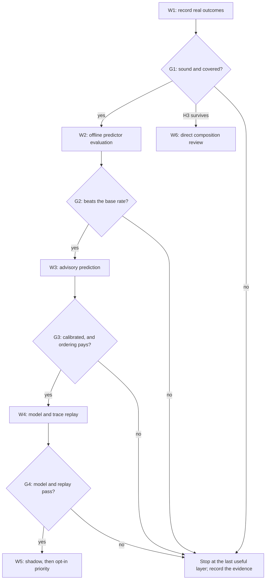

# RFC 0002: Recording and predicting sccache hits for queued compiles

## Preamble

- **RFC number:** 0002
- **Status:** Proposed
- **Created:** 2026-10-18
- **Baseline:** `main` at `32e2105`, with sccache 0.14.0 on the host. RFC
  0001, the FizzBee model of admission and recovery, has since been accepted
  and is on `main`[^1].
- **Scope:** observation and advisory prediction first. Any change to the
  order or cost of admission is gated behind recorded evidence and a model
  check, and none is proposed for immediate implementation.

## Summary

Nothing in buildlimits knows whether a compile was an sccache hit. A group is
known only as composed with the managed cache or without it, so an operator
cannot tell a queue of quick hits from a queue of long misses, and no proposal
to treat hits differently can be judged. This RFC proposes three layers, each
gated on evidence from the one before:

1. Record the real outcome of each cached compile, using a signal that can be
   attributed to one request and costs little.
2. Predict, from that history, whether a waiting request will hit, and show
   the prediction in `build-limits-status` and the metrics as advice only.
3. Only if the first two layers show both accuracy and a benefit, let
   predicted hits overtake predicted misses, after the change has been modelled
   in RFC 0001's FizzBee model.

The analysis rejects any form of cheaper admission that lets a cached compile
run without a full pool token. A mispredicted hit is a real compile inside the
sccache server's control group, and nothing can detect it before it starts.

## Problem

Operators and agents read `build-limits-status` to judge how long a build will
wait. Each waiting line shows the crate label, the working directory and the
time waited (`status.queued_requests`, `status_render._waiting_line`), but not
whether the work behind it is a 200-millisecond cache read or a five-minute
compile. The metrics record only the composition, as the `cache_path` tokens
`cached`, `direct` and `direct_fallback` (`metrics_schema.VOCABULARIES`,
`effect_dispatch.record_admitted`). Proposals to admit hits sooner keep
recurring, but each touches server-drain retention and cache recovery, and none
can be weighed without knowing how often hits occur, for which crates, and how
well they can be foreseen.

## Current state

### What the code records

- The adapter sends `argv`, `cwd`, `env`, `label` and `cacheable` with each
  request (`adapter._request_once`); `rustc_main` marks requests cacheable and
  `rustdoc_main` does not.
- `Admission.token_arrived` admits the head of a first-in, first-out queue
  (`queue.popleft()`) and composes the group with the cache only when the
  request is cacheable, `Admission.cached` holds and `cache_allowed()` permits
  it at that instant.
- `Groups.launch_spec` prefixes the sccache client and sets
  `SCCACHE_SERVER_UDS` and `SCCACHE_IGNORE_SERVER_IO_ERROR=1`. The client
  writes to the caller's own descriptors, passed with the request, so the
  supervisor never sees its output (user's guide, "What a build sees").
- A `Group` records `cached: bool` and nothing about the outcome
  (`admission_state.Group`). A cached group that ends abnormally is retained in
  `SERVER_DRAIN` (`Admission.group_emptied`, `Group.may_orphan_server_work`)
  until `ManagedSccache.accounted_drain` verifies a stopped, empty service
  (`ServerWatch._release_accounted`, `Admission.server_activity`). ADR 011
  requires live server work to stay covered by held tokens[^2].
- `proc_trees.count_children` counts visible compiler roots in the server's
  control group, as a diagnostic only, inside
  `ManagedSccache._diagnostic_roots`. It runs only when the drain probe
  (`ServerWatch.drained_tokens`, polled each second by
  `supervisor_polling._poll_server`) finds a live service while a
  `SERVER_DRAIN` token waits. It counts trees, not groups, and includes the
  dep-info children of hits (C3), which can only raise it, so the zero-root
  proof is never weakened.
- Recovery denies composition while it runs (`ServerWatch.hold_cache`), and its
  stop waits for `Counts.cached_moving` to reach zero
  (`recovery_starvation.blocked`).
- Metrics are identifier-free fields from a closed vocabulary, validated at
  the output boundary (`metrics.bounded_field`, `metrics_schema`).

### Constraints from sccache and Cargo

The host runs sccache 0.14.0 (`sccache --version`). Each fact below was read in
the source at tag `v0.14.0`; W1 confirms once, on the host, that the binary
behaves as its source reads.

- **C1. No lookup-only query.** The protocol's `Request` has exactly five
  variants: `ZeroStats`, `GetStats`, `DistStatus`, `Shutdown` and `Compile`,
  documented as "Execute a compile or fetch a cached compilation result"[^3].
  Nothing asks whether an entry exists without compiling.
- **C2. The client is told nothing.** A `Compile` is answered with
  `CompileStarted`, `UnhandledCompile` or `UnsupportedCompiler`, then
  `CompileFinished`, whose fields are `retcode`, `signal`, `stdout`, `stderr`
  and `color_mode` (C1's source). The outcome exists only as the server's
  `CompileResult` (`Error`, `CacheHit`, `CacheMiss`, `NotCached`,
  `NotCacheable`, `CompileFailed`), which feeds the global `ServerStats`[^4].
- **C3. The key needs a dep-info pass.** `generate_hash_key` hashes the cache
  version (`CACHE_VERSION`, a hand-maintained constant), the compiler's
  shared-library digests, the compiler's `-vV` version string, the command line
  without `-L`, `--extern`, `--check-cfg`, `--out-dir` and `--diagnostic-width`
  (with `--cfg` sorted, `--extern` pre-sorted at parse time), every source file
  named in the dep-info, extern rlib and staticlib digests, target JSON
  content, and environment variables: those in rustc's dep-info plus every
  `CARGO_*` variable except `CARGO_MAKEFLAGS`, `CARGO_REGISTRIES_*` and
  `CARGO_BUILD_JOBS`[^5]. The five-flag exclusion set is matched on the flag
  token alone, so a _path-valued_ `--target` is dropped only when the value
  names a `.json` file: the file's content is hashed instead, while a
  name-valued `--target` (`--target x86_64-unknown-linux-gnu`) stays in the
  hashed string. The executable's own path is never hashed directly, the
  sysroot is never hashed at all, and the `host:` triple is hashed only as part
  of the `-vV` string hashed above: it is a line of that string, and the reader
  takes it from there, but no separate `host` value reaches the hash. A source
  comment notes that absolute paths remain in the arguments, and
  `CARGO_MANIFEST_DIR` is absolute, so one crate in two worktrees has two keys.
  Registry crates under `~/.cargo/registry/src` have identical paths across
  worktrees. The source list comes from `get_source_files_and_env_deps`, which
  runs the compiler with `--emit=dep-info` as a child of the server for every
  request, hit or miss.
- **C4. Some requests are never cached.** `parse_arguments` refuses
  incremental compilation, unsupported crate types and several input files
  (`cannot_cache!("incremental")`, `cannot_cache!("crate-type", ...)`); the
  Rust notes add a required `--emit` including `link`, `--crate-name` and
  `--out-dir`[^6]. The server answers `UnhandledCompile`, and the client then
  runs the compiler itself (`handle_compile_response`)[^7], inside the compiler
  scope, not the server's control group.
- **C5. Statistics are global.** `ServerStats` includes `compile_requests`,
  `requests_not_compile`, `requests_not_cacheable`, `requests_executed`,
  per-language `cache_hits` and `cache_misses`, `cache_errors`,
  `non_cacheable_compilations`, `compile_fails` and `cache_read_hit_duration`,
  reported by `--show-stats --stats-format json` (C2's source). A delta cannot
  be attributed to one request while compiles overlap. `--show-stats` uses
  `connect_to_server` and reports empty statistics when it cannot connect,
  whereas `--zero-stats` and `--dist-status` use `connect_or_start_server` and
  would start a server (C4's client source). Every counter is a plain number:
  the struct holds no PID, start time or instance id, so a client cannot tell a
  restarted server from a continuing one, and a fresh server, a client-driven
  `--zero-stats` and _no server at all_ are all zero to a reader.
- **C7. A successful compile need not be cached.** `CompileResult` has a
  `NotCached` variant, produced when `SCCACHE_NO_CACHE` is set. The flag is
  read from the environment _forwarded with the request_, not the server's own,
  so it is a per-request decision that the forwarding side makes. This
  supervisor forwards the requester's environment for every cached launch and
  adds only `SCCACHE_SERVER_UDS` and `SCCACHE_IGNORE_SERVER_IO_ERROR`
  (`groups.compiler_argv`), so a requester that sets `SCCACHE_NO_CACHE` reaches
  the server with it. `NotCached` increments `compilations` and
  `compiler_write_duration` and nothing else: not `cache_misses`, not
  `non_cacheable_compilations`. It is answered with a normal success
  `CompileFinished`, so the client cannot distinguish the result from a hit or
  a miss. The `not_cached` field in `ServerStats` is unrelated: it is a
  reason-keyed histogram populated from `CannotCache`, not from this variant,
  and it counts _requests_, not compilations.
- **C6. The debug log cannot attribute hits.** With `SCCACHE_LOG=debug`, a
  miss logs `[<output>]: compile result: cache miss`, but a hit logs only
  `compile result: cache hit`, naming no request (C2's source).

Cargo sets `CARGO_PKG_NAME`, `CARGO_PKG_VERSION` and `CARGO_MANIFEST_DIR` for
each compiler invocation[^8], and its fingerprints skip fresh units[^9], so
every queued request is dirty as far as Cargo knows. A queued registry crate is
therefore usually a crate that another target directory has already built.

## Goals and non-goals

- Goals:
  - Record, for each cached compile where it can be attributed, whether it was
    a hit, a miss or not cacheable, without weakening any accounting.
  - Show an advisory, calibrated prediction beside each waiting request, and
    measure its accuracy from the journal alone.
  - Decide with evidence whether ordering admission by prediction is worth
    building, and model it before any implementation.
- Non-goals:
  - Predicting a hit by computing sccache's key, or probing the cache.
  - Changing composition, token accounting, `SERVER_DRAIN` release, the
    restart barrier or the recovery trigger in layers 1 and 2.
  - Exporting any history or path off the host, or predicting durations.

## Proposed design

For screen readers: the following flowchart shows the six workstreams and the
decision gate after each. Every gate either releases the next workstream or
stops with the evidence recorded.



_Figure 1: Layered workstreams and their decision gates._

### 1. Layer 1: record the real outcome

**Motivation.** Every later decision depends on knowing outcomes, and today
there are none. The signal must be attributable to one request, cheap, and
unable to disturb admission. Table 1 evaluates the candidates.

| Signal                               | Attributable to one request                                    | Cost                                        | Verdict                               |
| ------------------------------------ | -------------------------------------------------------------- | ------------------------------------------- | ------------------------------------- |
| Client output and exit path          | No: the reply carries no outcome (C2)                          | None                                        | Rejected                              |
| Server debug log                     | Misses by output name; hits not at all (C6)                    | Debug logging on a unit dev-env-rocky owns  | Rejected                              |
| Statistics deltas at quiet points    | Yes, in solo and unanimous windows, checked by the counts (C5) | One `--show-stats` call per window          | Chosen as the label of record         |
| Wall time and server-child arguments | Approximately: children are untagged, but carry `-C metadata`  | `/proc` reads per tick; short misses unseen | Hypothesis H2, checked against labels |

_Table 1: Candidate outcome signals._

A server child alone means nothing, because every request spawns a dep-info
pass (C3). A miss also spawns a full-emit `rustc` whose `-C metadata` value
matches the request's own arguments, and its group usually runs longer than
that key's hits. Those clues reach overlapping compiles, which window labels
cannot, but a one-second poll misses every short miss, so they are tested
against window labels (H2) before they label anything.

**Design.** The supervisor reads the server's statistics only at _quiet
points_: ticks where `Counts.cached_moving` and `Counts.server_drain` are both
zero, the cache is reachable, `cache_allowed()` is true and the recovery
transaction is idle. A pure function,
`cache_outcome.attribute(before, after, window)`, attributes the window between
consecutive readings:

- A window is eligible only if every cached group launched in it ended with a
  known exit, uncancelled and unsignalled (`not may_orphan_server_work`), and
  no counter decreased, which would mean a restarted server.
- Each reading carries a _server generation_: the `InvocationID` systemd gives
  the sccache unit's current invocation, read as one more property name on the
  `manager.show` call the supervisor already makes to inspect the unit, so no
  extra process is spawned and the transport's existing three-second bound
  still applies. The unit restarts the server its own way after a failure (ADR
  011), so that id is the server's identity, and a window whose two readings
  differ is rejected however the counters moved. This closes the case the
  decrease test cannot see: a restart from an all-zero baseline, or one
  followed by enough work to exceed the old values, would otherwise attribute
  post-restart deltas to the previous server's launches. While no invocation is
  running the generation is _no server_, and a window with an absent server at
  either end is rejected — which the cache-reachability precondition already
  implies, but which the generation check now makes explicit rather than
  inferred. C5 still holds: the marker comes from the unit, not from
  `ServerStats`, so an unmanaged or out-of-unit server stays indistinguishable
  and the decrease test remains the backstop for it. One implementation
  constraint carries over: the public user-bus fallback in
  `buildlimits/bus_properties.py` accepts only `MainPID`, `ControlGroup` and
  `ActiveState`, and rejects any other property name, so W1 must extend that
  set with `InvocationID` or treat the fallback's refusal as an unavailable
  reading rather than a `BusQueryError`.
- The change in `compile_requests` must equal the number of cached groups
  launched in the window, and the outcome counters must account for exactly
  that same number of requests in total. A request the server answers without a
  compile moves one of two counters, and W1 must place it in the right one.
  `requests_not_compile` counts a command line the compiler's own parser
  classes as no compile at all, such as `--version`, `-V` or `--print`.
  `requests_not_cacheable` counts one that parser refused to cache, which is
  where Cargo's `-vV` probe lands at 0.14.0, under the refusal `missing input`,
  because `-vV` is not an argument the parser knows. Neither counter is
  additive with the result counters: a refusal accounts for its request in
  place of `cache_hits`, `cache_misses`, `non_cacheable_compilations` or
  `compile_fails`, not on top of one, and it moves neither
  `non_cacheable_compilations`, which counts a finished compile whose result
  was not cacheable, nor `compilations`.
- The outcome moved is read from the counters, since the reply carries none
  (C2). The table below shows the counter movements at 0.14.0, taken from the
  result handlers in `server.rs`; `_` means the counter does not move.

  | `CompileResult`        | `cache_hits` | `compilations` | `cache_misses` | `non_cacheable_compilations` | `compile_fails` | `cache_errors` |
  | ---------------------- | ------------ | -------------- | -------------- | ---------------------------- | --------------- | -------------- |
  | `CacheHit`             | +1           | _              | _              | _                            | _               | _              |
  | `CacheMiss`            | _            | +1             | +1             | _                            | _               | _ or +1        |
  | `NotCached`            | _            | +1             | _              | _                            | _               | _              |
  | `NotCacheable`         | _            | +1             | _              | +1                           | _               | _              |
  | `CompileFailed`        | _            | +1             | _              | _                            | +1              | _              |
  | `CompileResult::Error` | _            | _              | _              | _                            | _               | +1             |

  A `CacheMiss` moves `cache_errors` too when its cache read failed
  (`MissType::CacheReadError`), so that column does not identify an error.

  A hit is read from `cache_hits`, which nothing else moves, and
  `not_cacheable` from `non_cacheable_compilations`. `not_cached` is the only
  class with no counter of its own: it is a `compilations` increase that leaves
  the rest of the table still. `compile_fails` has two increment sites, and
  `compilations` tells them apart: `CompileFailed` moves it together with
  `compilations` and is the `failed` class, while `Err(ProcessError)` — a
  failure raised outside the `CompileResult` variants — moves it alone and is an
  `error`. The other `error` sites, `CompileResult::Error` and the fatal-error
  arm, move `cache_errors` alone. A miss whose cache read failed moves that
  counter too, but never on its own, since it also moves `compilations` and
  `cache_misses`, so a solo `cache_errors` movement still identifies an `error`
  and nothing else.
- Each of those footprints moves at least one column, so a window whose columns
  are all still covers no requests, and one whose launched groups the counters
  cannot account for fails the count rule above and is rejected rather than
  attributed.
- Taken one request at a time, each footprint has a signature of its own, and
  that is what makes a solo window's label a reading rather than a guess. Those
  signatures are not independent, so a sum does not determine its own split: an
  `error` that moved `compile_fails` alone, a `miss` whose read failed and a
  `not_cached` add up to the same delta as an `error` that moved `cache_errors`
  alone, a `failed` and a plain `miss`, at the same three requests, and the two
  windows differ in the classes their outcomes landed in. Splitting a mixed
  window would need more than the counters and the count can supply. The rules
  above never ask them to split a window. A window that is neither solo nor
  unanimous is `unattributed` before the question arises, so a coinciding total
  cannot be read as a settled outcome, and an ambiguous window costs coverage
  rather than soundness.
- A _solo_ window, one group, takes that request's single outcome. A
  _unanimous_ window, with several groups that all hit, all missed, were all
  not cacheable or were all not cached, gives each group that outcome. Every
  other window is `unattributed`, which is the outcome token; the event's
  `attribution` field carries `none` for the same window, since `inferred`,
  `solo` and `unanimous` are the only labels the attribution itself can claim.
  The two names are deliberately different: the outcome says what the groups
  were given, and the attribution says what the reading was able to establish.

A reading must not stop the loop. `Supervisor.serve` runs a single
single-threaded selector (`supervisor.Supervisor`), so a query awaited in place
would suspend request acceptance, pool-token arrival and group reaping for as
long as `--show-stats` takes, on every tick. The reading is therefore a
contract rather than a call site: whatever mechanism carries it, the loop must
keep serving those three duties for the whole two seconds a query may last, and
a stalled query must cost only the reading it abandoned. A query that misses
its deadline is abandoned and its process reaped; the tick records
`unattributed` and the next tick starts a fresh query rather than waiting on
the previous one. A reading is always compared with the last reading the
sequence accepted, so the windows meet end to end rather than overlapping: an
abandoned query yields no window at all, and an accepted reading's window is
the interval between itself and its predecessor, however many ticks apart they
fall. Every launch therefore falls in exactly one window and no request can be
attributed twice, which is what lets the count check above reject a window
rather than accept a double count. Lateness costs coverage, never soundness,
and a persistently stalling `--show-stats` degrades coverage rather than
admission.

Outcomes are `hit`, `miss`, `not_cacheable`, `not_cached`, `failed`, `error` and
`unattributed`. `not_cached` is the C7 result: a successful compile the
requester's forwarded `SCCACHE_NO_CACHE` kept out of the cache. It is recorded
so that a site which sets the flag can tell "nothing was stored because nobody
asked" from "a cold cache", and it is deliberately excluded from the estimate:
it enters neither a key's hit rate, nor its origin's base rate, nor the
observation count the classification threshold reads. A disabled cache is not
evidence about the cache, so counting it as a miss would report a hit rate the
cache never had, while counting it as an observation would let a site that
always sets the flag promote a key to `likely miss` on records that measured
nothing. The key stays `uncertain` until real cache outcomes arrive, and the
excluded count is reported beside the rates so the omission is visible. Each
record carries the request's normalized key (§2), wall time, origin class and,
where a tick saw one, whether a full-emit child with its `-C metadata` was
present, so that W2 can evaluate predictors and H2 offline. The query is
`sccache --show-stats --stats-format json` against the managed socket, with a
proposed two-second timeout, at most once per tick and never between a token's
arrival and its launch.

**Safety invariants.**

- I1. Observation only: no decision in `admission`, `server_watch`,
  `cache_recovery` or `recovery_starvation` reads an outcome. The import
  boundary that `tests/test_admission.py` pins grows to cover the new modules.
- I2. The supervisor never starts a server outside the unit (`sccache` module
  docstring). It issues only `--show-stats`, which at 0.14.0 never starts one
  (C5), never `--zero-stats` or `--dist-status`, and never queries under a hold
  or while the cache is unreachable.
- I3. Failures are isolated as metrics failures are: a timeout, a parse error
  or empty statistics yields `unattributed`, never an unhealthy supervisor, and
  a stalled query never delays admission, which the test strategy pins by
  counting loop iterations across a deliberately stalled reading. Each of those
  failures is also _named_: `outcome_reason` distinguishes them, so a stretch
  of sustained read failures is visible in the journal rather than appearing as
  low coverage.
- I4. An attributed label is never inferred. Any class from H2's clues is
  reported separately as `inferred`.

**Observability.** A new `cache_outcome` event carries the tokens
`cache_result`, `attribution` (`solo`, `unanimous`, `inferred` or `none`),
`origin` (`registry`, `git`, `path` or `unknown`) and `outcome_reason`, with
`runtime_seconds`. `origin` is `unknown` only when `CARGO_MANIFEST_DIR` is
absent, because a value that is present always normalizes: §2 sends every
directory that is neither a registry nor a git checkout to `path`. An unknown
origin stops neither step. The window is still attributed and its outcome still
recorded, because attribution never needed the origin, while §2's derivation
has no origin value to fold into a key and so reports `key_unavailable` for
that request. `outcome_reason` is `none` exactly when a label was produced — by
an attributed window (`solo` or `unanimous`) or by I4's inference
(`inferred`) — and otherwise names why the reading produced no label: `timeout`,
`read_error`, `parse_error`, `empty_stats`, `generation_changed`,
`counter_decreased`, `count_mismatch`, `ineligible_window` or `no_quiet_point`.
`timeout` is the deadline elapsing and `read_error` is any other failure of the
query itself — a launch failure, a socket error or a transport read — so a
query that never returns statistics is named rather than sharing the timeout's
token or falling through unnamed. `outcome_reason` covers the reading alone: it
is a second closed vocabulary beside the new-event token set, because the
schema's existing `reason` field already carries admission refusals
(`metrics_schema.VOCABULARIES`), and widening the event without a distinct
field would make a rejected window indistinguishable from a refusal in the
journal. The evaluation surface has its own vocabulary (Layer 2) rather than
reusing this one, so a reading that failed and a request that could not be
classified are never confused in the journal. No reason carries a key, a path
or an argument. The boundaries the proposal crosses are recorded as bounded
`JournalTracer` spans — `statistics_read`, `outcome_store_load`,
`outcome_store_save`, `prediction_evaluate` and `admission_selection` — with
fixed operation names, bounded attributes and elapsed milliseconds, exported
through the existing injected sink and dropped on failure without affecting the
operation (ADR 003). Both span vocabularies are closed and must be extended by
the release that adds these: `JournalTracer.start` refuses an operation absent
from `tracing_export.OPERATIONS`, and `_bounded_attributes` keeps only
attributes with a registered vocabulary, so an unregistered operation is
dropped by design and an unregistered attribute is omitted rather than exported
as free text. `build-limits-metrics` reports outcome counts, attributed
coverage and a count per reason.

**Ports.** Everything this layer reads or writes that is not its own memory is
reached through a narrow injected port, so the reads and writes have declared
shapes, their failures stay isolable, and a test can drive the layer without a
clock, a socket or a file system. Four ports carry it, and no more, which keeps
the count independent of the retry and scoring work layer 2 adds later:

- a clock port offering monotonic and wall-clock readings separately, because
  the deadline is measured against the monotonic reading while a record stores
  the wall-clock one, and only the second may move when the host's time does;
- a statistics port returning one bounded document for the managed socket, the
  command it runs being the port's own business
  (`--show-stats --stats-format json`, never `--zero-stats` or `--dist-status`,
  per I2);
- an outcome-store port offering a bounded load and an atomic save, with the
  store's path, its 10,000-record bound and its 30-day aging behind it; and
- a salt port offering one per-host random value, which is the only source the
  path digest draws on.

Each port declares its success and failure alternatives explicitly rather than
raising a shared exception, so the reasons above stay the caller's to attach.
Table 2 gives the alternatives each operation returns and the reason token its
failure carries.

| Port       | Operation          | Success               | Failure reason                              |
| ---------- | ------------------ | --------------------- | ------------------------------------------- |
| clock      | monotonic reading  | seconds, total        | none: the read cannot fail                  |
| clock      | wall-clock reading | seconds, total        | none: the read cannot fail                  |
| statistics | read one document  | bounded document      | `timeout`, `read_error`                     |
| store      | load history       | bounded records       | `corrupt`, `unreadable`, `version_mismatch` |
| store      | save history       | saved                 | `save_failed`                               |
| salt       | acquire the value  | per-host random value | `salt_unavailable`                          |

_Table 2: Port operations and the reason each failure carries._

The reason column names the vocabulary each failure is reported through, and a
fault's vocabulary follows the operation that failed rather than the fault
itself. The statistics row draws on `outcome_reason`, whose tokens §1 defines
above. The load row names the store's read alternatives, and the save row names
`save_failed`; both belong to `store_reason`, which §2's observability
paragraph defines in full. `salt_unavailable` is one more `store_reason`
because the salt lives in a file the store owns (§2 privacy), so the vocabulary
that already names "the persistent state could not be read or written" is the
one that should name this fault too. The layer adds one reason token and no new
vocabulary, so the closed sets a reader must know stay at three:
`outcome_reason`, `store_reason` and `evaluation_reason`.

Both clock reads are total: the two readings are the OS's, and neither can fail
in a way the layer must handle, so a clock port has no failure alternative, and
its fake exists to move the deadline, not to fail. `expired` and `tag_dropped`
are outcomes of the store's _contents_, not of a load or a save, so the store's
own reporting carries them, and a load returns them in the record set rather
than through an operation's failure alternative. Like every other token,
`salt_unavailable` is a fixed identifier carrying no path or value.

A missing salt is not a degraded path to a raw path. The digest is the only
representation of a path this layer may persist or compare, so when the salt
cannot be obtained the layer returns no digest: the compile's toolchain
identity and any `path:` origin are unkeyable, and no record is written for
that compile. The two layers do different work, so each names the operation it
could not complete, in the vocabulary that owns it, and one missing salt can
therefore produce a reason at each layer. Layer 1 reports `store_reason`
`salt_unavailable` because the file it could not read is one the store owns:
the save is what cannot happen. Layer 2 still attempts the history load, and
reports `evaluation_reason` `key_unavailable` when it cannot key the request at
all; `store_unavailable` is reserved for the load that failed independently, so
a missing salt never also produces `store_unavailable` by itself, and neither
reason is reported for a request the layer never reached. Attribution itself is
unaffected because the counters never needed the digest. The attributed label
and its `cache_outcome` event are the same whether or not the salt was
available — that event carries no key, no digest and no toolchain identity — so
the reading is still named and still counted in the coverage the journal
reports; what is lost is the keyed record in the store, not the attribution.
"Unchanged attribution" and "unchanged persisted records" are therefore
different claims, and it is the first that holds here. The raw path is never
substituted, and an unsalted digest is never written, which is the same ban
§2's privacy bound states, applied at the point where the choice could
otherwise be made.

Nothing in the design requires a port for what the layer does not call: the
pure parts below are given values, not ports. Attribution, the counter
arithmetic, the record shape and the classification run on the values they are
handed, so they hold no port and touch no clock, socket or file. The reading
path composes: it asks the clock for a deadline, the statistics port for a
document, and the store port for history, and returns the attributed records
beside the reasons in place of the current side effects that emit a span or
save a file. The caller writes the spans and the records, so the pure functions
cannot emit telemetry or persist by accident, and a port that fails costs the
reading rather than the supervisor (I3). `JournalSink`, `MetricsPort` and
`rustdoc.run_rustup` are the existing ports this follows; the store and salt
ports are new, and the clock and statistics ports replace direct reads the
layer would otherwise make.

**Test strategy.** Unit tests cover statistics parsing across empty, partial
and malformed documents, and an exhaustive truth table of the attribution rules
over small deltas, in the style of `tests/test_recovery_starvation.py`: one row
per outcome class the derivation above can produce, including the `not_cached`
delta that moves `compilations` alone, both `error` deltas — the one that moves
`compile_fails` alone and the one that moves `cache_errors` alone — the
ambiguous windows in which differing mixes of outcomes produce identical
deltas, and rows for a window whose two readings carry different server
generations, which must be `unattributed` even when every counter rose and the
count check would otherwise pass. The `hit` row is the one that pins the
derivation's direction: a `cache_hits` increase with no `compilations` movement
must be attributed a hit, and a `compilations` increase with no `cache_hits`
movement must not be, which a decrease-only or hits-from-`compilations`
implementation fails. A Hypothesis state machine drives overlapping cached and
uncached groups, abnormal endings and server restarts — one restart placing the
new generation's counters above the old, so the decrease test alone would
accept it — against a model server that knows each true outcome: every
attributed label must equal the truth, no mixed window may be attributed, and
the search must reach a solo and a unanimous window, so it cannot pass
vacuously. `systemd_user` scenarios (`make test-systemd-user`) extend
`tests/fixtures/fake_sccache.py` with a statistics command and scripted
outcomes, and show that labels match the script and that no query runs while
the restart barrier exists. A stalled statistics command with a slow scripted
answer must leave the loop admitting: the test counts iterations, accepts a
request and returns a token while the query is outstanding, which is the
regression check for the contract above. Each `outcome_reason` token has a test
that provokes it and asserts the reason, so the vocabulary cannot rot into a
single catch-all. The `timeout` test provokes the deadline, and the
`read_error` test a query that fails before it can time out — a launch failure,
a socket error or a transport read — so the two are distinguished rather than
both claimed by one test. The ports make each of those failures a fake's return
rather than a real timeout, socket or file: a fake statistics port answers from
a script, a fake store port fails a load or a save on demand, a fake clock
moves the deadline, and a fake salt port refuses on demand. Each failure in
Table 2 is provoked and its declared reason asserted, so a port contract cannot
be added without a test that observes it: a refused save yields `save_failed`,
a load over an unreadable file yields `unreadable` where a permission-denied
read makes the file unreadable rather than corrupt, and a refused salt yields
`salt_unavailable`. The salt tests assert the whole declared behaviour rather
than the reason alone — that no record is written for the affected compile,
that no raw path and no unsalted digest reaches the store or a comparison, that
the attribution and its `cache_outcome` event are nevertheless unchanged, and
that admission is unchanged — which is the pair of claims the salt paragraph
separates. The salt test also asserts which reason each layer reports, because
the two layers reach the missing salt differently: layer 1 asserts
`store_reason` `salt_unavailable` for the save it could not make, and layer 2
asserts `evaluation_reason` `key_unavailable` for the request it could not key
and asserts that `store_unavailable` is _not_ reported for that same request.
Boundary tests assert the rest of the separation the ports exist for: that a
reading writes no file and emits no telemetry, that a save writes only the
store, and that a raising sink leaves the reading's own result and the loop
unchanged. Two failures need their own assertion, because the two are easy to
confuse: a timed-out reading produces no attributed label for the affected
window and reports `outcome_reason` `timeout`, so the test asserts the absence
of a label, the reason and unchanged admission rather than an equality with a
successful close; a failed store save is a persistence failure _after_ a
reading that succeeded, so the test asserts the computed attribution is
unchanged and the caller reports `store_reason` `save_failed`. The first must
never be written as the second: a reading that produced no label has none to
preserve, and asserting that it leaves attribution unchanged would pass
vacuously against an implementation that dropped the label silently. Together
those assertions are the isolation ADR 003 requires of telemetry and the reason
the pure functions return their events instead of emitting them. An opt-in host
check with the real 0.14.0 binary builds one small registry crate cold and then
warm, confirming C2 and C5: the hit is invisible in the reply, and only the
statistics move. C4 is confirmed separately rather than assumed, because a
cold-then-warm build of a cacheable crate exercises no refusal: the check reads
the counters once more after the build and requires the refusal Cargo's own
toolchain probe produces. Cargo asks the compiler for its version with `-vV`
before it compiles anything, that flag is not in the parser's argument table,
and the request is therefore refused as uncacheable rather than as
not-a-compile, which moves `requests_not_cacheable` and leaves
`requests_not_compile` alone. A build whose counters show the one and not the
other is the host evidence for C4's refusal path, and the same reading
distinguishes the two counters the count rule above depends on.

**Privacy.** Records use the normalized key of §2 and stay on the host; child
arguments are compared in memory and never stored; the journal receives only
closed-vocabulary tokens.

**Storage.** G2 must be decided from layer 1's own records, so the keyed
records are written in layer 1, not layer 2: the same append-only,
atomically-written local file §2 describes, at
`$XDG_STATE_HOME/buildlimits/cache-outcomes.json`, holding key, outcome,
origin, wall time, toolchain identity and timestamp per attributed record. The
journal keeps only the closed-vocabulary event; the file is the only place a
key is written to disk, it never leaves the host, and it is read by `W2`'s
offline replay and by nothing in `admission`. Its bounds, aging and atomicity
are §2's, and deleting it costs only the replay. Layer 2 reuses this store
rather than introducing a second one, so a `W2` that decides against prediction
leaves one removable file behind and no other trace.

**Measurement for the next layer.** After at least 2,000 attributed outcomes (a
proposal), compute coverage by origin, the outcome mix, and an offline replay
of candidate predictors against the base-rate predictor (H1 to H5), grouping
the stored records by key and comparing each key's consecutive outcomes. This
decides layer 2 without building it.

### 2. Layer 2: predict from history

**Motivation.** A calibrated "likely hit" or "likely miss" beside a waiting
request tells an operator or agent what the queue costs, and turns the claim
that hits can be foreseen into something the journal can check.

**Design.** The key is derived purely from the recorded request:

- the crate name, from `--crate-name` as `heartbeat.crate_label` reads it;
- the origin, from `CARGO_MANIFEST_DIR` relative to `CARGO_HOME` (by default
  `~/.cargo`): `registry/src/<index>/<name>-<version>` becomes
  `registry:<name>@<version>`, `git/checkouts/<name>-<hash>/<rev>` becomes
  `git:<name>@<rev>`, and any other directory becomes `path:<salted digest>`,
  which is per worktree, as sccache's key is (C3);
- the target, from `--target`, or `host`;
- a toolchain identity: the compiler path, its `-vV` version string, and the
  `CACHE_VERSION` constant. The path enters the identity as a per-host salted
  digest, the same representation §2's privacy bound requires of every local
  path, and that digest is what a record persists and what the tag comparison
  compares; the raw path stays in memory. Two identities are equal exactly when
  their path digests, `-vV` strings and `CACHE_VERSION` constants all are, so
  matching a stored tag never needs the path that produced it. This is an
  _approximate_ identity, deliberately not the full set `generate_hash_key`
  folds into a key (C3). The shared-library digests are excluded, because they
  digest every file in the rustc sysroot's `lib/` (C3) and cost a full sysroot
  hash per server start for no requirement here. The approximation is not
  one-directional, and both directions are stated rather than one being claimed
  away. A sysroot changed in place under an unchanged compiler path, `-vV`
  string and `CACHE_VERSION` leaves this identity unchanged, so the identity
  cannot exclude that change and the affected history is mislabelled; the
  change stays a confounder for H4 and H5, which measure it rather than ruling
  it out. Conversely the identity can separate records sccache's key does not:
  the compiler path is in this identity but is never hashed into a key (C3), so
  one key can span two identities, and a request moved to a byte-identical
  compiler at another path starts a fresh history under a key that did not
  change;
- an argument digest: SHA-256 over the argument vector after sccache's own
  removals and sorting (C3), with the `CARGO_*` variables that sccache hashes.

The argument digest covers the normalized argument vector and the hashed
`CARGO_*` variables, but it does not close the approximation: it cannot see the
target JSON file's content, which sccache hashes whenever a path-valued
`--target` names one (C3), nor the dep-info source-file, extern rlib and
staticlib digests, nor the compile's working directory and the dep-info
environment values, which `generate_hash_key` hashes as inputs 8 and 9 (C3). A
target JSON file changed under an unchanged path, a changed source or
dependency, a compile run from a different directory, or a changed environment
value listed in dep-info, is therefore a confounder that H4 and H5 measure. The
working directory and the dep-info environment values are listed as confounders
rather than added to the key: sccache hashes the whole dep-info environment,
and the key is defined by what the recorded request can supply without a
dep-info pass. A request whose arguments match C4 is classed `not_cacheable`,
but only while H3 survives. Otherwise each key keeps its last eight outcomes,
and a Beta estimate with a prior from its origin's base rate gives the
probability of a hit. The proposed classes are `likely hit` for at least 0.8
with three or more observations, `likely miss` for at most 0.2 with three or
more, `uncertain` otherwise, and `no history` for a new key. The class is
computed once, at submission.

History lives in memory, bounded to the 10,000 most recent records (a
proposal), and is saved atomically, on a timer and at stop, to the same
`$XDG_STATE_HOME/buildlimits/cache-outcomes.json` that layer 1 fills, each
record tagged with the toolchain identity it was taken under, so a record whose
tag no longer matches is dropped rather than asked to explain a toolchain
change the identity records. The drop is limited to changes the tag actually
detects: a change that leaves the identity's inputs alone is invisible to this
test, so the record survives it and the confounder reaches the estimate rather
than being filtered out. A file whose own format version is not the one this
release writes reports `version_mismatch` and is discarded unread, which is
distinct from `corrupt`: the file is well-formed, and only the schema it was
written under is unknown, so a downgrade or a forward-written file is named
rather than reported as damage. A corrupt file is discarded, and the discard is
named: `store_reason` distinguishes `corrupt`, `unreadable`, `version_mismatch`,
`tag_dropped` and `salt_unavailable` — the last naming the salt file it also
owns (§1 ports) — so a store that is silently unreadable on every start is
visible rather than merely making prediction look unauthoritative. The
vocabulary names every path the store can take, not only the read paths:
`save_failed` covers a save that could not be written, and `expired` covers the
records the 30-day aging bound drops, so a save failing on every stop or an
aging bound discarding more than expected is visible rather than merely making
prediction look unauthoritative, which is the same job the load reasons do. A
failed save names itself and does not disturb the running estimate.

The status document gains an optional `prediction` object per queued request,
with `class`, `p_hit` and `observations`, which the renderer appends:

```plaintext
waiting 9.0s: serde in /home/owner/project; likely hit (p=0.97, 12 observations)
```

The prediction is advisory and must never weaken safety accounting.

**Safety invariants.**

- P1. Admission never reads a prediction. Queue order, composition,
  `cache_allowed`, `SERVER_DRAIN` retention and release, and every recovery
  decision are unchanged, enforced by the import boundary and by a differential
  check that admission's effects are identical with prediction on and off.
- P2. A failure in prediction or the store yields `no history`, never a
  refusal or an unhealthy supervisor.
- P3. Memory and persistence are bounded, and saving never runs on the
  admission decision path.
- P4. A status document without predictions renders exactly as today.

**Observability.** `request_admitted` and `cache_outcome` gain a `prediction`
token and a `confidence_pct` counter, so the journal alone yields a confusion
matrix and a calibration curve by origin. The store reports `store_reason` when
it loads, saves or discards, and the evaluation reports its own
`evaluation_reason` — a third closed vocabulary, distinct from the reading's
`outcome_reason` and the store's `store_reason` — when it cannot classify a
request: `none` when it reached a class of its own, `key_unavailable` when the
request could not be keyed, `store_unavailable` when the history could not be
read, which carries the store's own reason alongside it, and `ineligible` when
the request is not cacheable under C4, which is a class taken from the
request's arguments rather than from the evaluation, so it is reported as its
own reason rather than as `none`. `uncertain` and `no history` are classes the
evaluation computed, not failures of it, so they always carry `none` and never
a reason of their own; `none` therefore means the classification ran to
completion and produced a class from history, and every other token means it
did not. Each token is a fixed identifier carrying no key, path or argument, so
a reader can tell a failed reading, a failed store and a request that could not
be classified apart, and `uncertain` and `no history` are never the only
explanation a reader gets.

**Test strategy.** Unit tests cover normalization of registry, git and path
origins, a non-default `CARGO_HOME` and missing variables. Hypothesis checks
that a stored `path:` key never contains a separator or any component of its
path, and that the estimator stays within `[0, 1]` and never falls when a hit
is added, with a CrossHair contract on its bounds; a differential machine shows
identical admission effects with and without predictions. Snapshots, paired
with semantic assertions, pin status with and without predictions, and a
`systemd_user` scenario shows predictions appearing after warm-up against the
scripted fake server. Each `store_reason` token is provoked and asserted, which
covers the whole vocabulary rather than only the load paths: a store that fails
on one path and not another is caught by the reason rather than by the fallback
alone, and the same test set must provoke `save_failed` on a refused write and
`expired` on the aging bound, so neither can be added to the vocabulary without
a test that observes it. Each `evaluation_reason` token is provoked the same
way, and a test asserts that `uncertain` and `no history` arrive with `none`
rather than a reason, so a produced class can never be reported as a failed
evaluation. A test also asserts that a request the evaluation could not key is
still admitted unchanged — the isolation P2 requires — so a classification
failure costs a class and never a token.

**Privacy.** Crate names and registry versions are public metadata. Local paths
are stored only as digests salted with a per-host random value, kept in a file
of mode 0600 beside the history in a directory of mode 0700, so a digest cannot
be checked against a guessed path elsewhere. History is never journalled or
exported, deleting it resets prediction, and records untouched for 30 days are
dropped (a proposal). Status already shows the working directory, only to the
same user (`SO_PEERCRED`, developer's guide §8), so the display discloses
nothing new. These bounds are layer 1's as well, because layer 1 writes the
same file: the salt, the modes, the 30-day aging and the ban on export all
apply from the moment recording starts.

**Measurement for the next layer.** Online accuracy and calibration (H6), and a
trace replay of recorded arrivals, predictions and runtimes under first-in,
first-out and under bounded priority (H7), including the share of busy time in
which likely hits and likely misses wait together. If they rarely do, ordering
has nothing to reorder.

### 3. Layer 3: cheaper admission for predicted hits

**Motivation.** Hits are expected to be short, and a first-in, first-out queue
places them behind long misses, so serving likely hits first could cut the mean
wait. This is the riskiest layer. Five facts constrain every option:

1. A mispredicted hit is a full compile in the server's control group, outside
   any scope. It cannot be detected before it starts (C1, C2), or moved or
   preempted alone, so a pool token must cover it from launch: ADR 011's
   coverage rule, and property S6 of RFC 0001. Even a true hit runs a dep-info
   pass there (C3).
2. A cached group that ends abnormally must keep a token in `SERVER_DRAIN`
   (`Admission.group_emptied`); a group without its own token has none to keep.
3. Under a recovery hold, `token_arrived` composes every group without the
   cache, so a predicted hit admitted then is a full direct compile.
4. The stop waits for `cached_moving` to reach zero. Exempting predicted hits
   from the hold would let a stream of them defer the stop indefinitely, the
   shape of incident 1 in RFC 0001, and a mispredicted miss in that stream is
   the work the stop must not interrupt.
5. The staleness trigger reads only retained drains and the queue length
   (`recovery_starvation.starvation`), so reordering leaves its inputs alone.

| Option                                             | Effect on the accounting                                                            | Verdict                            |
| -------------------------------------------------- | ----------------------------------------------------------------------------------- | ---------------------------------- |
| 3A. Probe slots beyond the pool                    | A miss runs uncovered (fact 1); an abnormal ending cannot be retained (fact 2)      | Rejected unless ADR 011 is revised |
| 3B. Priority with bounded bypass                   | Every group still holds one token; only the choice of waiting request changes       | Candidate, after modelling         |
| 3C. Short lane, full slot on a miss                | A miss is known only after it starts, so it runs uncovered in between               | Rejected for sccache 0.14.0        |
| 3D. Compose provably uncacheable requests directly | No prediction; the server refuses such a request and does no cache work for it (C4) | Candidate, gated on H3 only        |

_Table 3: Options for cheaper admission._

3C could be reconsidered only if sccache gained a hook before the compile
starts, or if the server's wait for a jobserver slot before spawning drew from
a pool that buildlimits controls (open question 2). 3D is not prediction, but
it is the one way of making cached admission cheaper that also improves safety:
a request that sccache refuses to cache gains nothing from the server, yet
today counts in `cached_moving` and can be retained in `SERVER_DRAIN`.
Composing it directly removes both, and a wrong argument rule costs only a lost
hit.

**Design of 3B.** `Admission.token_arrived` takes the oldest waiting request
classed `likely hit`, but only when that request would be composed with the
cache at this instant (`cached`, `cache_allowed()` and `cacheable`), and only
while every request the promotion would skip has been overtaken fewer than K
times (K is 4, a proposal); otherwise it takes the head of the queue. The bound
is exclusive so that it holds Q3 exactly: a request already overtaken K times
is never skipped again, because the guard admits no further overtake of it.
Each request the promotion skips has its bypass count incremented, and the
count of the request that takes the token is left alone — it was not skipped.
The class arrives as immutable data at `submit`, so the core stays pure. Shadow
mode comes first: the choice is computed and recorded, but the head is still
admitted.

**Safety invariants.** 3B relaxes P1 to "a prediction affects only which
waiting request takes a token".

- Q1. Every admitted group holds exactly one pool token from launch until its
  accounted return.
- Q2. Composition is decided only by `cached` and `cache_allowed()` at token
  arrival; a prediction never makes a group cached or exempt from a hold.
- Q3. A waiting request is overtaken at most K times.
- Q4. Under a hold, while uncached, and for rustdoc, the order is first-in,
  first-out.

**Model first.** Once RFC 0001's model covers its full scope (its W2), extend
it with predicted classes in the queue and an environment that picks each
request's true outcome regardless of its prediction. The expected results: S3
and S6 hold for 3B; without the bypass bound K, L2 fails through a lasso in
which a busy queue of predicted hits starves a predicted miss; with the bound,
L2 holds; and a known-bad 3A configuration violates S6 with one mispredicted
miss, which keeps the model's discriminating power checked. The bound the model
must exercise is K, not the store's 30-day aging, which is a different bound on
a different thing.

**Observability, privacy and measurement.** `request_admitted` gains a
`promoted` boolean, and `would_promote` in shadow mode; status shows each
waiting request's bypass count. The selection itself is recorded as an
`admission_selection` `JournalTracer` span with fixed attributes and elapsed
milliseconds, in the same bounded shape as the Layer 1 spans (ADR 003): the
chosen request's class, whether the choice was a promotion or the head of the
queue, the bypass count the winner carried, and `stop_mode` when a hold forced
first-in, first-out. Those attributes reach the journal only if the release
registers them, as Layer 1 requires of its spans: `admission_selection` joins
`tracing_export.OPERATIONS`, and `selection_choice`, carrying `promotion`,
`head` or `hold`, joins the bounded attribute vocabularies rather than relying
on the existing `outcome`, `failure_category`, `stop_mode` and `retry_attempt`
entries. The span therefore carries no key and no argument, and one that cannot
be exported is dropped without affecting the admission decision. Layer 3 stores
nothing beyond layer 2. Before anything is enabled, shadow mode's observed p50
and p90 waits for each class are compared with those the replay predicted.

**Test strategy.** The admission state machine in `tests/test_admission.py`
gains predicted classes, adversarial true outcomes and a bypass counter, and
checks token conservation, S6, the bypass bound and first-in, first-out order
under a hold; with every class `uncertain`, effects must equal today's. A
CrossHair contract covers the pure selection function. `systemd_user` scenarios
cover shadow and enabled modes, and a recovery stop that completes while
promoted hits keep arriving. Each `selection_choice` value is provoked and
asserted in the same style as the Layer 1 and Layer 2 reasons, so a promotion,
a head-of-queue choice and a hold forcing first-in, first-out are each observed
rather than inferred from the admission order alone.

## Hypotheses and decision gates

The thresholds below are proposals, to be approved before any data is read.

- **H1. Attributable labels.** _Assumption:_ the host binary behaves as the
  0.14.0 source reads (C2, C5). _Prediction:_ no attributed label disagrees
  with the truth in at least 200 scripted and controlled windows, and coverage
  on the host is at least 20% of cached requests. _Falsified if:_ any label is
  wrong, or coverage is below 5%. _Decision:_ a wrong label stops W1 until the
  rules are fixed; below 5%, H2 is the only route to coverage; from 5% to 20%,
  proceed with the limit reported.
- **H2. Wall time and child arguments separate outcomes.** _Assumption:_ most
  misses that matter leave a visible full-emit child, and a key's hits are
  shorter than its misses. _Prediction:_ a classifier combining wall time,
  against the key's history, with a sighted child agrees with at least 95% of
  window labels for keys with both outcomes. _Falsified if:_ below 90%.
  _Decision:_ if it survives, report `inferred` outcomes for overlapping
  compiles, apart from labels (I4); if falsified, keep wall time for display
  and stop sampling children.
- **H3. Arguments decide non-cacheability.** _Prediction:_ every attributed
  request with a C4 feature is `not_cacheable`, and none without one is.
  _Falsified if:_ one counterexample occurs. _Decision:_ if it survives, W6 may
  go to design review; if falsified, drop the deterministic class.
- **H4. Registry crates are predictable.** _Prediction:_ registry crates at a
  pinned version with an unchanged argument digest hit at least 95% of the time
  on this host after their first attributed observation. _Comparator:_ the
  registry base rate. _Falsified if:_ below 90%. _Decision:_ if it survives,
  layer 2 is worth building for registry crates; if falsified, revise the
  normalization once (H5), then stop.
- **H5. The digest is adequate.** _Prediction:_ at most 5% of consecutive
  outcome pairs within one key flip without a toolchain change. _Falsified if:_
  above 10%, meaning the key merges requests that sccache distinguishes.
  _Decision:_ revise once, then report the key as inadequate. Every pair's
  toolchain identity is compared before the pair is counted, so a change the
  identity records is excluded rather than charged to the digest. A change it
  does not record is not excluded: a sysroot changed in place under an
  unchanged compiler path, `-vV` string and `CACHE_VERSION` compares equal, so
  its flips stay in the count. H5 therefore bounds the digest's adequacy _in
  combination with_ that residual, and an H5 failure is not by itself evidence
  that the digest is at fault — the cause of a flip cannot be read off the
  counters, so neither outcome settles it.
- **H6. Online calibration and lift.** _Prediction:_ over at least 1,000
  predictions, `likely hit` hits at least 90% of the time, calibration is
  within 5 points per decile, and the Brier score beats the base-rate predictor
  by at least 0.05. _Falsified if:_ any of these fails. _Decision:_ keep
  recording, and show only `uncertain` or remove the display.
- **H7. Ordering pays.** _Prediction:_ the replay shows 3B with K at 4 cutting
  the mean wait over all requests by at least 15%, raising no class's p90 wait
  by more than 10%, with both classes waiting together for at least 10% of busy
  time. _Falsified if:_ any of these fails. _Decision:_ stop at layer 2.
- **H8. The model agrees.** _Prediction:_ the four model results of §3.
  _Falsified if:_ 3B violates S3, S6 or L2 with the bound, or 3A yields no
  counterexample. _Decision:_ a 3B failure stops layer 3, and its
  counterexample becomes a regression test; a silent 3A means the model needs
  correcting first.

A surviving hypothesis is not proven. Labels come from solo and unanimous
windows, which favour quiet and uniform periods, so every verdict must state
that its sample may not represent busy, mixed traffic.

## Workstreams

Table 4 proposes the workstreams in dependency order. The dependencies are
acyclic, and the identifiers are proposals.

| ID  | Outcome                                                      | Requires              | Exit evidence                         | Gate                             |
| --- | ------------------------------------------------------------ | --------------------- | ------------------------------------- | -------------------------------- |
| W1  | Host check of C2, C4 and C5; layer 1 recording               | None                  | H1 to H3 verdicts; coverage by origin | G1: proceed, narrow or stop      |
| W2  | Offline predictor evaluation over W1 records                 | W1 at G1              | H4 and H5 verdicts                    | G2: build advisory prediction?   |
| W3  | Advisory prediction in status and metrics                    | W2 at G2              | H6 verdict from the journal           | G3: consider ordering?           |
| W4  | 3B and known-bad 3A in RFC 0001's model; trace replay        | W3 at G3; RFC 0001 W2 | H7 and H8 verdicts                    | G4: shadow mode?                 |
| W5  | Shadow mode, then opt-in priority                            | W4 at G4              | Shadow waits agree with the replay    | G5: owner decides on the default |
| W6  | Design review of direct composition for uncacheable requests | W1 with H3 surviving  | Accepted or rejected ADR              | Parent decision                  |

_Table 4: Proposed workstreams, their evidence and the decisions they enable._

## Compatibility and migration

Each layer ships behind a supervisor key that is off by default:
`cache_outcomes` (`off` or `record`), `cache_prediction` (`off` or `advisory`)
and `hit_priority` (`off`, `shadow` or `on`), all names being proposals.
Unknown keys stop start-up (user's guide, "Supervisor settings"), so the
dev-env-rocky collection may set a key only after the release that introduces
it. The status document changes additively, and `metrics.decode_native_fields`
ignores unknown fields, but the metric schema does not: a new event is a
compatibility break rather than an addition, and the break is precise enough to
state now (open question 6). `metrics_records._record` returns no record at all
when the event is absent from `metrics_schema.EVENTS`
(`if event not in EVENTS: return None`), so an older `build-limits-metrics`
reading the journal drops every `cache_outcome` record whole rather than
ignoring the event it does not know. Unknown _vocabulary values_ behave
differently and are the narrower case: `metrics.bounded_field` returns no value
for a token outside `metrics_schema.VOCABULARIES`, and `decode_native_fields`
omits that field while still returning the record, so an unrecognized
`outcome_reason` or `store_reason` costs one field and an unrecognized event
costs the record. Layer 1 therefore needs a release that adds `cache_outcome` to
`EVENTS` before the recording key is enabled, and a reader predating that
release sees an empty `cache_outcome` history rather than a partial one. That
is why the key is off by default, so enabling it is a deliberate act taken with
the release that adds the event. The record store is new and disposable, and
turning a key off is a complete rollback: layer 1 does not delete it, because
running the `W2` replay is the point of recording. An sccache upgrade repeats
W1's host check before recording resumes, because C1 to C6 were read from
0.14.0. The `outcome_reason`, `store_reason` and `evaluation_reason`
vocabularies are new schema entries, so they carry open question 6's
compatibility check with them, and each is additive: a reader that ignores an
unknown token still reads the event. The user's guide sections "Status" and
"Metrics", and §§4, 5 and 9 of the developer's guide, change with each layer.
Enabling 3B or 3D needs an ADR, and 3A or 3C would need ADR 011 revised.

## Alternatives considered

### Option A: a lookup-only probe or a reimplemented key

There is no probe (C1). Reimplementing the key (C3) would mean running the
dep-info pass outside admission and hashing every input, which is most of the
cost of a hit, and would couple buildlimits to a cache version that changes
between releases, with every error silent. The option is rejected.

### Option B: an upstream sccache change

Adding the outcome to `CompileFinished`, or naming the output in the hit log
line as the miss line already does (C6), would make layer 1 exact for every
compile, remove the bias of quiet windows, and help sccache users generally. It
is worth proposing upstream as a follow-up, but buildlimits must work with the
installed version, so the option is deferred, not adopted.

### Option C: retain the current behaviour

This costs only knowledge, is the safest option, and is the outcome of any
failed gate. Labels from wall time alone are not a fourth option: a dep-info
pass on a large crate and a full compile of a small one can take similar times,
so wall time is tested only as a supplement (H2).

## Open questions

1. Does the dev-env-rocky collection pin the sccache version that
   `sccache_executable` resolves to, so that an upgrade is visible?
2. Which jobserver gates the managed server's wait before it spawns a
   compiler (ADR 011)? The answer decides whether 3C could ever be sound.
3. Does sccache cache `clippy-driver` invocations, which reach the supervisor
   with `clippy-driver` before `rustc` (`groups.compiler_argv`)?
4. How long does the dep-info pass take on the largest crates on this host;
   is a hit always short (H2)?
5. Should prediction history persist across supervisor restarts, or stay in
   memory, and should a finished group's status line show its recorded outcome?
   Layer 1's records persist either way, since the replay needs them.
6. The reader's behaviour is settled by source rather than open: an older
   `build-limits-metrics` drops an unknown event whole (`metrics_records`) and
   omits only the field for an unknown vocabulary value (`bounded_field`), as
   the compatibility section states. What remains open is the rollout: does the
   release adding `cache_outcome` to `metrics_schema.EVENTS` reach every reader
   of the journal before layer 1's recording key is enabled there?
7. Should W6 be decided as a composition-policy ADR independently of this RFC?

## Recommendation

Approve W1 and W2 now. Recording is observation only, and an offline evaluation
of its records decides whether prediction is worth building before any of it is
built. Decide layer 2 at G2. Treat layer 3 as 3B or nothing: no cheaper
admission that lets a cached compile run without a full pool token is
compatible with ADR 011, because a mispredicted hit is an undetectable real
compile in the server's control group. 3B proceeds only after RFC 0001's model
and the trace replay both pass. W6 deserves its own decision once H3 has
survived.

[^1]: RFC 0001, `docs/rfcs/0001-fizzbee-model-of-admission-and-recovery.md`,
      accepted 2026-10-18 and present on `main`.

[^2]: ADR 011, dev-env-rocky:
      <https://github.com/leynos/dev-env-rocky/blob/main/docs/adr-011-sccache-under-compile-admission.md>

[^3]: sccache v0.14.0, `src/protocol.rs`:
      <https://github.com/mozilla/sccache/blob/v0.14.0/src/protocol.rs>

[^4]: sccache v0.14.0, `src/compiler/compiler.rs` and `src/server.rs`:
      <https://github.com/mozilla/sccache/blob/v0.14.0/src/compiler/compiler.rs>,
      <https://github.com/mozilla/sccache/blob/v0.14.0/src/server.rs>

[^5]: sccache v0.14.0, `src/compiler/rust.rs`, `generate_hash_key`:
      <https://github.com/mozilla/sccache/blob/v0.14.0/src/compiler/rust.rs>

[^6]: sccache v0.14.0, `docs/Rust.md`:
      <https://github.com/mozilla/sccache/blob/v0.14.0/docs/Rust.md>

[^7]: sccache v0.14.0, `src/commands.rs`:
      <https://github.com/mozilla/sccache/blob/v0.14.0/src/commands.rs>

[^8]: The Cargo Book, "Environment variables Cargo sets for crates",
      retrieved 2026-10-18:
      <https://doc.rust-lang.org/cargo/reference/environment-variables.html>

[^9]: The Cargo Book, "Build cache", retrieved 2026-10-18:
      <https://doc.rust-lang.org/cargo/reference/build-cache.html>
