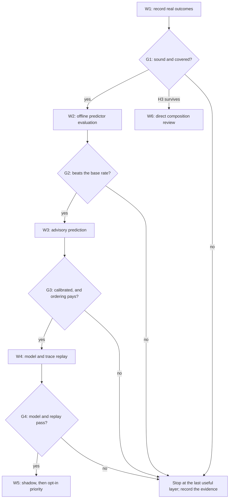

# RFC 0002: Recording and predicting sccache hits for queued compiles

## Preamble

- **RFC number:** 0002
- **Status:** Proposed
- **Created:** 2026-10-18
- **Baseline:** `main` at `37d08e5`, with sccache 0.14.0 on the host. RFC
  0001, the FizzBee model of admission and recovery, is under review in PR #11
  and is cited here as proposed, not accepted[^1].
- **Scope:** observation and advisory prediction first. Any change to the
  order or cost of admission is gated behind recorded evidence and a model
  check, and none is proposed for immediate implementation.

## Summary

Nothing in buildlimits knows whether a compile was an sccache hit. A group is
known only as composed with the managed cache or without it, so an operator
cannot tell a queue of quick hits from a queue of long misses, and no proposal
to treat hits differently can be judged. This RFC proposes three layers, each
gated on evidence from the one before:

1. Record the real outcome of each cached compile, using a signal that can be
   attributed to one request and costs little.
2. Predict, from that history, whether a waiting request will hit, and show
   the prediction in `build-limits-status` and the metrics as advice only.
3. Only if the first two layers show both accuracy and a benefit, let
   predicted hits overtake predicted misses, after the change has been modelled
   in RFC 0001's FizzBee model.

The analysis rejects any form of cheaper admission that lets a cached compile
run without a full pool token. A mispredicted hit is a real compile inside the
sccache server's control group, and nothing can detect it before it starts.

## Problem

Operators and agents read `build-limits-status` to judge how long a build will
wait. Each waiting line shows the crate label, the working directory and the
time waited (`status.queued_requests`, `status_render._waiting_line`), but not
whether the work behind it is a 200-millisecond cache read or a five-minute
compile. The metrics record only the composition, as the `cache_path` tokens
`cached`, `direct` and `direct_fallback` (`metrics_schema.VOCABULARIES`,
`effect_dispatch.record_admitted`). Proposals to admit hits sooner keep
recurring, but each touches server-drain retention and cache recovery, and none
can be weighed without knowing how often hits occur, for which crates, and how
well they can be foreseen.

## Current state

### What the code records

- The adapter sends `argv`, `cwd`, `env`, `label` and `cacheable` with each
  request (`adapter._request_once`); `rustc_main` marks requests cacheable and
  `rustdoc_main` does not.
- `Admission.token_arrived` admits the head of a first-in, first-out queue
  (`queue.popleft()`) and composes the group with the cache only when the
  request is cacheable, `Admission.cached` holds and `cache_allowed()` permits
  it at that instant.
- `Groups.launch_spec` prefixes the sccache client and sets
  `SCCACHE_SERVER_UDS` and `SCCACHE_IGNORE_SERVER_IO_ERROR=1`. The client
  writes to the caller's own descriptors, passed with the request, so the
  supervisor never sees its output (user's guide, "What a build sees").
- A `Group` records `cached: bool` and nothing about the outcome
  (`admission_state.Group`). A cached group that ends abnormally is retained in
  `SERVER_DRAIN` (`Admission.group_emptied`, `Group.may_orphan_server_work`)
  until `ManagedSccache.accounted_drain` verifies a stopped, empty service
  (`ServerWatch._release_accounted`, `Admission.server_activity`). ADR 011
  requires live server work to stay covered by held tokens[^2].
- `proc_trees.count_children` counts visible compiler roots in the server's
  control group, as a diagnostic only, inside
  `ManagedSccache._diagnostic_roots`. It runs only when the drain probe
  (`ServerWatch.drained_tokens`, polled each second by
  `supervisor_polling._poll_server`) finds a live service while a
  `SERVER_DRAIN` token waits. It counts trees, not groups, and includes the
  dep-info children of hits (C3), which can only raise it, so the zero-root
  proof is never weakened.
- Recovery denies composition while it runs (`ServerWatch.hold_cache`), and its
  stop waits for `Counts.cached_moving` to reach zero
  (`recovery_starvation.blocked`).
- Metrics are identifier-free fields from a closed vocabulary, validated at
  the output boundary (`metrics.bounded_field`, `metrics_schema`).

### Constraints from sccache and Cargo

The host runs sccache 0.14.0 (`sccache --version`). Each fact below was read in
the source at tag `v0.14.0`; W1 confirms once, on the host, that the binary
behaves as its source reads.

- **C1. No lookup-only query.** The protocol's `Request` has exactly five
  variants: `ZeroStats`, `GetStats`, `DistStatus`, `Shutdown` and `Compile`,
  documented as "Execute a compile or fetch a cached compilation result"[^3].
  Nothing asks whether an entry exists without compiling.
- **C2. The client is told nothing.** A `Compile` is answered with
  `CompileStarted`, `UnhandledCompile` or `UnsupportedCompiler`, then
  `CompileFinished`, whose fields are `retcode`, `signal`, `stdout`, `stderr`
  and `color_mode` (C1's source). The outcome exists only as the server's
  `CompileResult` (`Error`, `CacheHit`, `CacheMiss`, `NotCached`,
  `NotCacheable`, `CompileFailed`), which feeds the global `ServerStats`[^4].
- **C3. The key needs a dep-info pass.** `generate_hash_key` hashes the cache
  version, the compiler's shared-library digests, the command line without `-L`,
  `--extern`, `--out-dir` and `--diagnostic-width` (with `--extern`, `-L` and
  `--cfg` sorted), every source file named in the dep-info, extern rlib and
  staticlib digests, target JSON content, and environment variables: those in
  rustc's dep-info plus every `CARGO_*` variable except `CARGO_MAKEFLAGS`,
  `CARGO_REGISTRIES_*` and `CARGO_BUILD_JOBS`[^5]. A source comment notes that
  absolute paths remain in the arguments, and `CARGO_MANIFEST_DIR` is absolute,
  so one crate in two worktrees has two keys. Registry crates under
  `~/.cargo/registry/src` have identical paths across worktrees. The source
  list comes from `get_source_files_and_env_deps`, which runs the compiler with
  `--emit=dep-info` as a child of the server for every request, hit or miss.
- **C4. Some requests are never cached.** `parse_arguments` refuses
  incremental compilation, unsupported crate types and several input files
  (`cannot_cache!("incremental")`, `cannot_cache!("crate-type", ...)`); the
  Rust notes add a required `--emit` including `link`, `--crate-name` and
  `--out-dir`[^6]. The server answers `UnhandledCompile`, and the client then
  runs the compiler itself (`handle_compile_response`)[^7], inside the compiler
  scope, not the server's control group.
- **C5. Statistics are global.** `ServerStats` includes `compile_requests`,
  `requests_not_compile`, `requests_not_cacheable`, `requests_executed`,
  per-language `cache_hits` and `cache_misses`, `cache_errors`,
  `non_cacheable_compilations`, `compile_fails` and `cache_read_hit_duration`,
  reported by `--show-stats --stats-format json` (C2's source). A delta cannot
  be attributed to one request while compiles overlap. `--show-stats` uses
  `connect_to_server` and reports empty statistics when it cannot connect,
  whereas `--zero-stats` and `--dist-status` use `connect_or_start_server` and
  would start a server (C4's client source).
- **C6. The debug log cannot attribute hits.** With `SCCACHE_LOG=debug`, a
  miss logs `[<output>]: compile result: cache miss`, but a hit logs only
  `compile result: cache hit`, naming no request (C2's source).

Cargo sets `CARGO_PKG_NAME`, `CARGO_PKG_VERSION` and `CARGO_MANIFEST_DIR` for
each compiler invocation[^8], and its fingerprints skip fresh units[^9], so
every queued request is dirty as far as Cargo knows. A queued registry crate is
therefore usually a crate that another target directory has already built.

## Goals and non-goals

- Goals:
  - Record, for each cached compile where it can be attributed, whether it was
    a hit, a miss or not cacheable, without weakening any accounting.
  - Show an advisory, calibrated prediction beside each waiting request, and
    measure its accuracy from the journal alone.
  - Decide with evidence whether ordering admission by prediction is worth
    building, and model it before any implementation.
- Non-goals:
  - Predicting a hit by computing sccache's key, or probing the cache.
  - Changing composition, token accounting, `SERVER_DRAIN` release, the
    restart barrier or the recovery trigger in layers 1 and 2.
  - Exporting any history or path off the host, or predicting durations.

## Proposed design

For screen readers: the following flowchart shows the six workstreams and the
decision gate after each. Every gate either releases the next workstream or
stops with the evidence recorded.



_Figure 1: Layered workstreams and their decision gates._

### 1. Layer 1: record the real outcome

**Motivation.** Every later decision depends on knowing outcomes, and today
there are none. The signal must be attributable to one request, cheap, and
unable to disturb admission. Table 1 evaluates the candidates.

| Signal                               | Attributable to one request                                    | Cost                                        | Verdict                               |
| ------------------------------------ | -------------------------------------------------------------- | ------------------------------------------- | ------------------------------------- |
| Client output and exit path          | No: the reply carries no outcome (C2)                          | None                                        | Rejected                              |
| Server debug log                     | Misses by output name; hits not at all (C6)                    | Debug logging on a unit dev-env-rocky owns  | Rejected                              |
| Statistics deltas at quiet points    | Yes, in solo and unanimous windows, checked by the counts (C5) | One `--show-stats` call per window          | Chosen as the label of record         |
| Wall time and server-child arguments | Approximately: children are untagged, but carry `-C metadata`  | `/proc` reads per tick; short misses unseen | Hypothesis H2, checked against labels |

_Table 1: Candidate outcome signals._

A server child alone means nothing, because every request spawns a dep-info
pass (C3). A miss also spawns a full-emit `rustc` whose `-C metadata` value
matches the request's own arguments, and its group usually runs longer than
that key's hits. Those clues reach overlapping compiles, which window labels
cannot, but a one-second poll misses every short miss, so they are tested
against window labels (H2) before they label anything.

**Design.** The supervisor reads the server's statistics only at _quiet
points_: ticks where `Counts.cached_moving` and `Counts.server_drain` are both
zero, the cache is reachable, `cache_allowed()` is true and the recovery
transaction is idle. A pure function,
`cache_outcome.attribute(before, after, window)`, attributes the window between
consecutive readings:

- A window is eligible only if every cached group launched in it ended with a
  known exit, uncancelled and unsignalled (`not may_orphan_server_work`), and
  no counter decreased, which would mean a restarted server.
- The change in `compile_requests` must equal the number of cached groups
  launched in the window, and the outcome counters, including
  `requests_not_compile` for Cargo's `-vV` probes, must account for exactly
  that many requests.
- A _solo_ window, one group, takes that request's single outcome. A
  _unanimous_ window, with several groups that all hit, all missed or were all
  not cacheable, gives each group that outcome. Every other window is
  `unattributed`.

Readings run on the event loop, so no group launches during one. An outcome
counted late fails the count check in both windows it touches, so lateness
costs coverage, never soundness. Outcomes are `hit`, `miss`, `not_cacheable`,
`failed`, `error` and `unattributed`. Each record carries the request's
normalized key (§2), wall time, origin class and, where a tick saw one, whether
a full-emit child with its `-C metadata` was present, so that W2 can evaluate
predictors and H2 offline. The query is
`sccache --show-stats --stats-format json` against the managed socket, with a
proposed two-second timeout, at most once per tick and never between a token's
arrival and its launch.

**Safety invariants.**

- I1. Observation only: no decision in `admission`, `server_watch`,
  `cache_recovery` or `recovery_starvation` reads an outcome. The import
  boundary that `tests/test_admission.py` pins grows to cover the new modules.
- I2. The supervisor never starts a server outside the unit (`sccache` module
  docstring). It issues only `--show-stats`, which at 0.14.0 never starts one
  (C5), never `--zero-stats` or `--dist-status`, and never queries under a hold
  or while the cache is unreachable.
- I3. Failures are isolated as metrics failures are: a timeout, a parse error
  or empty statistics yields `unattributed`, never an unhealthy supervisor.
- I4. An attributed label is never inferred. Any class from H2's clues is
  reported separately as `inferred`.

**Observability.** A new `cache_outcome` event carries the tokens
`cache_result`, `attribution` (`solo`, `unanimous`, `inferred` or `none`) and
`origin` (`registry`, `git`, `path` or `unknown`), with `runtime_seconds`.
`build-limits-metrics` reports outcome counts and attributed coverage.

**Test strategy.** Unit tests cover statistics parsing across empty, partial
and malformed documents, and an exhaustive truth table of the attribution rules
over small deltas, in the style of `tests/test_recovery_starvation.py`. A
Hypothesis state machine drives overlapping cached and uncached groups,
abnormal endings and server restarts against a model server that knows each
true outcome: every attributed label must equal the truth, no mixed window may
be attributed, and the search must reach a solo and a unanimous window, so it
cannot pass vacuously. `systemd_user` scenarios (`make test-systemd-user`)
extend `tests/fixtures/fake_sccache.py` with a statistics command and scripted
outcomes, and show that labels match the script and that no query runs while
the restart barrier exists. An opt-in host check with the real 0.14.0 binary
builds one small registry crate cold and then warm, confirming C2, C4 and C5.

**Privacy.** Records use the normalized key of §2 and stay on the host; child
arguments are compared in memory and never stored; the journal receives only
closed-vocabulary tokens.

**Measurement for the next layer.** After at least 2,000 attributed outcomes (a
proposal), compute coverage by origin, the outcome mix, and an offline replay
of candidate predictors against the base-rate predictor (H1 to H5). This
decides layer 2 without building it.

### 2. Layer 2: predict from history

**Motivation.** A calibrated "likely hit" or "likely miss" beside a waiting
request tells an operator or agent what the queue costs, and turns the claim
that hits can be foreseen into something the journal can check.

**Design.** The key is derived purely from the recorded request:

- the crate name, from `--crate-name` as `heartbeat.crate_label` reads it;
- the origin, from `CARGO_MANIFEST_DIR` relative to `CARGO_HOME` (by default
  `~/.cargo`): `registry/src/<index>/<name>-<version>` becomes
  `registry:<name>@<version>`, `git/checkouts/<name>-<hash>/<rev>` becomes
  `git:<name>@<rev>`, and any other directory becomes `path:<salted digest>`,
  which is per worktree, as sccache's key is (C3);
- the target, from `--target`, or `host`;
- an argument digest: SHA-256 over the argument vector after sccache's own
  removals and sorting (C3), with the `CARGO_*` variables that sccache hashes
  and a digest of the compiler path for toolchain identity.

The digest cannot see sccache's source and extern rlib digests, so a changed
source or dependency is a confounder that H4 and H5 measure. A request whose
arguments match C4 is classed `not cacheable`, but only while H3 survives.
Otherwise each key keeps its last eight outcomes, and a Beta estimate with a
prior from its origin's base rate gives the probability of a hit. The proposed
classes are `likely hit` for at least 0.8 with three or more observations,
`likely miss` for at most 0.2 with three or more, `uncertain` otherwise, and
`no history` for a new key. The class is computed once, at submission.

History lives in memory, bounded to 10,000 keys with least-recently-used
eviction (a proposal), and is saved atomically, on a timer and at stop, to
`$XDG_STATE_HOME/buildlimits/cache-history.json`. A corrupt file is discarded.
The status document gains an optional `prediction` object per queued request,
with `class`, `p_hit` and `observations`, which the renderer appends:

```plaintext
waiting 9.0s: serde in /home/owner/project; likely hit (p=0.97, 12 observations)
```

The prediction is advisory and must never weaken safety accounting.

**Safety invariants.**

- P1. Admission never reads a prediction. Queue order, composition,
  `cache_allowed`, `SERVER_DRAIN` retention and release, and every recovery
  decision are unchanged, enforced by the import boundary and by a differential
  check that admission's effects are identical with prediction on and off.
- P2. A failure in prediction or the store yields `no history`, never a
  refusal or an unhealthy supervisor.
- P3. Memory and persistence are bounded, and saving never runs on the
  admission decision path.
- P4. A status document without predictions renders exactly as today.

**Observability.** `request_admitted` and `cache_outcome` gain a `prediction`
token and a `confidence_pct` counter, so the journal alone yields a confusion
matrix and a calibration curve by origin.

**Test strategy.** Unit tests cover normalization of registry, git and path
origins, a non-default `CARGO_HOME` and missing variables. Hypothesis checks
that a stored `path:` key never contains a separator or any component of its
path, and that the estimator stays within `[0, 1]` and never falls when a hit
is added, with a CrossHair contract on its bounds; a differential machine shows
identical admission effects with and without predictions. Snapshots, paired
with semantic assertions, pin status with and without predictions, and a
`systemd_user` scenario shows predictions appearing after warm-up against the
scripted fake server.

**Privacy.** Crate names and registry versions are public metadata. Local paths
are stored only as digests salted with a per-host random value, kept in a file
of mode 0600 beside the history in a directory of mode 0700, so a digest cannot
be checked against a guessed path elsewhere. History is never journalled or
exported, deleting it resets prediction, and keys unused for 30 days are
dropped (a proposal). Status already shows the working directory, only to the
same user (`SO_PEERCRED`, developer's guide §8), so the display discloses
nothing new.

**Measurement for the next layer.** Online accuracy and calibration (H6), and a
trace replay of recorded arrivals, predictions and runtimes under first-in,
first-out and under bounded priority (H7), including the share of busy time in
which likely hits and likely misses wait together. If they rarely do, ordering
has nothing to reorder.

### 3. Layer 3: cheaper admission for predicted hits

**Motivation.** Hits are expected to be short, and a first-in, first-out queue
places them behind long misses, so serving likely hits first could cut the mean
wait. This is the riskiest layer. Five facts constrain every option:

1. A mispredicted hit is a full compile in the server's control group, outside
   any scope. It cannot be detected before it starts (C1, C2), or moved or
   pre-empted alone, so a pool token must cover it from launch: ADR 011's
   coverage rule, and property S6 of RFC 0001. Even a true hit runs a dep-info
   pass there (C3).
2. A cached group that ends abnormally must keep a token in `SERVER_DRAIN`
   (`Admission.group_emptied`); a group without its own token has none to keep.
3. Under a recovery hold, `token_arrived` composes every group without the
   cache, so a predicted hit admitted then is a full direct compile.
4. The stop waits for `cached_moving` to reach zero. Exempting predicted hits
   from the hold would let a stream of them defer the stop indefinitely, the
   shape of incident 1 in RFC 0001, and a mispredicted miss in that stream is
   the work the stop must not interrupt.
5. The staleness trigger reads only retained drains and the queue length
   (`recovery_starvation.starvation`), so reordering leaves its inputs alone.

| Option                                             | Effect on the accounting                                                       | Verdict                            |
| -------------------------------------------------- | ------------------------------------------------------------------------------ | ---------------------------------- |
| 3A. Probe slots beyond the pool                    | A miss runs uncovered (fact 1); an abnormal ending cannot be retained (fact 2) | Rejected unless ADR 011 is revised |
| 3B. Priority with bounded bypass                   | Every group still holds one token; only the choice of waiting request changes  | Candidate, after modelling         |
| 3C. Short lane, full slot on a miss                | A miss is known only after it starts, so it runs uncovered in between          | Rejected for sccache 0.14.0        |
| 3D. Compose provably uncacheable requests directly | No prediction; such requests never use the server (C4)                         | Candidate, gated on H3 only        |

_Table 2: Options for cheaper admission._

3C could be reconsidered only if sccache gained a hook before the compile
starts, or if the server's wait for a jobserver slot before spawning drew from
a pool that buildlimits controls (open question 2). 3D is not prediction, but
it is the one way of making cached admission cheaper that also improves safety:
a request that sccache refuses to cache gains nothing from the server, yet
today counts in `cached_moving` and can be retained in `SERVER_DRAIN`.
Composing it directly removes both, and a wrong argument rule costs only a lost
hit.

**Design of 3B.** `Admission.token_arrived` takes the oldest waiting request
classed `likely hit`, but only when that request would be composed with the
cache at this instant (`cached`, `cache_allowed()` and `cacheable`), and only
while no waiting request has been overtaken more than K times (K is 4, a
proposal); otherwise it takes the head of the queue. The class arrives as
immutable data at `submit`, so the core stays pure. Shadow mode comes first:
the choice is computed and recorded, but the head is still admitted.

**Safety invariants.** 3B relaxes P1 to "a prediction affects only which
waiting request takes a token".

- Q1. Every admitted group holds exactly one pool token from launch until its
  accounted return.
- Q2. Composition is decided only by `cached` and `cache_allowed()` at token
  arrival; a prediction never makes a group cached or exempt from a hold.
- Q3. A waiting request is overtaken at most K times.
- Q4. Under a hold, while uncached, and for rustdoc, the order is first-in,
  first-out.

**Model first.** Once RFC 0001's model covers its full scope (its W2), extend
it with predicted classes in the queue and an environment that picks each
request's true outcome regardless of its prediction. The expected results: S3
and S6 hold for 3B; without the aging bound, L2 fails through a lasso in which
a busy queue of predicted hits starves a predicted miss; with the bound, L2
holds; and a known-bad 3A configuration violates S6 with one mispredicted miss,
which keeps the model's discriminating power checked.

**Observability, privacy and measurement.** `request_admitted` gains a
`promoted` boolean, and `would_promote` in shadow mode; status shows each
waiting request's bypass count. Layer 3 stores nothing beyond layer 2. Before
anything is enabled, shadow mode's observed p50 and p90 waits for each class
are compared with those the replay predicted.

**Test strategy.** The admission state machine in `tests/test_admission.py`
gains predicted classes, adversarial true outcomes and a bypass counter, and
checks token conservation, S6, the bypass bound and first-in, first-out order
under a hold; with every class `uncertain`, effects must equal today's. A
CrossHair contract covers the pure selection function. `systemd_user` scenarios
cover shadow and enabled modes, and a recovery stop that completes while
promoted hits keep arriving.

## Hypotheses and decision gates

The thresholds below are proposals, to be approved before any data is read.

- **H1. Attributable labels.** _Assumption:_ the host binary behaves as the
  0.14.0 source reads (C2, C5). _Prediction:_ no attributed label disagrees
  with the truth in at least 200 scripted and controlled windows, and coverage
  on the host is at least 20% of cached requests. _Falsified if:_ any label is
  wrong, or coverage is below 5%. _Decision:_ a wrong label stops W1 until the
  rules are fixed; below 5%, H2 is the only route to coverage; from 5% to 20%,
  proceed with the limit reported.
- **H2. Wall time and child arguments separate outcomes.** _Assumption:_ most
  misses that matter leave a visible full-emit child, and a key's hits are
  shorter than its misses. _Prediction:_ a classifier combining wall time,
  against the key's history, with a sighted child agrees with at least 95% of
  window labels for keys with both outcomes. _Falsified if:_ below 90%.
  _Decision:_ if it survives, report `inferred` outcomes for overlapping
  compiles, apart from labels (I4); if falsified, keep wall time for display
  and stop sampling children.
- **H3. Arguments decide non-cacheability.** _Prediction:_ every attributed
  request with a C4 feature is `not_cacheable`, and none without one is.
  _Falsified if:_ one counterexample occurs. _Decision:_ if it survives, W6 may
  go to design review; if falsified, drop the deterministic class.
- **H4. Registry crates are predictable.** _Prediction:_ registry crates at a
  pinned version with an unchanged argument digest hit at least 95% of the time
  on this host after their first attributed observation. _Comparator:_ the
  registry base rate. _Falsified if:_ below 90%. _Decision:_ if it survives,
  layer 2 is worth building for registry crates; if falsified, revise the
  normalization once (H5), then stop.
- **H5. The digest is adequate.** _Prediction:_ at most 5% of consecutive
  outcome pairs within one key flip without a toolchain change. _Falsified if:_
  above 10%, meaning the key merges requests that sccache distinguishes.
  _Decision:_ revise once, then report the key as inadequate.
- **H6. Online calibration and lift.** _Prediction:_ over at least 1,000
  predictions, `likely hit` hits at least 90% of the time, calibration is
  within 5 points per decile, and the Brier score beats the base-rate predictor
  by at least 0.05. _Falsified if:_ any of these fails. _Decision:_ keep
  recording, and show only `uncertain` or remove the display.
- **H7. Ordering pays.** _Prediction:_ the replay shows 3B with K at 4 cutting
  the mean wait over all requests by at least 15%, raising no class's p90 wait
  by more than 10%, with both classes waiting together for at least 10% of busy
  time. _Falsified if:_ any of these fails. _Decision:_ stop at layer 2.
- **H8. The model agrees.** _Prediction:_ the four model results of §3.
  _Falsified if:_ 3B violates S3, S6 or L2 with the bound, or 3A yields no
  counterexample. _Decision:_ a 3B failure stops layer 3, and its
  counterexample becomes a regression test; a silent 3A means the model needs
  correcting first.

A surviving hypothesis is not proven. Labels come from solo and unanimous
windows, which favour quiet and uniform periods, so every verdict must state
that its sample may not represent busy, mixed traffic.

## Workstreams

Table 3 proposes the workstreams in dependency order. The dependencies are
acyclic, and the identifiers are proposals.

| ID  | Outcome                                                      | Requires              | Exit evidence                         | Gate                             |
| --- | ------------------------------------------------------------ | --------------------- | ------------------------------------- | -------------------------------- |
| W1  | Host check of C2, C4 and C5; layer 1 recording               | None                  | H1 to H3 verdicts; coverage by origin | G1: proceed, narrow or stop      |
| W2  | Offline predictor evaluation over W1 records                 | W1 at G1              | H4 and H5 verdicts                    | G2: build advisory prediction?   |
| W3  | Advisory prediction in status and metrics                    | W2 at G2              | H6 verdict from the journal           | G3: consider ordering?           |
| W4  | 3B and known-bad 3A in RFC 0001's model; trace replay        | W3 at G3; RFC 0001 W2 | H7 and H8 verdicts                    | G4: shadow mode?                 |
| W5  | Shadow mode, then opt-in priority                            | W4 at G4              | Shadow waits agree with the replay    | G5: owner decides on the default |
| W6  | Design review of direct composition for uncacheable requests | W1 with H3 surviving  | Accepted or rejected ADR              | Parent decision                  |

_Table 3: Proposed workstreams, their evidence and the decisions they enable._

## Compatibility and migration

Each layer ships behind a supervisor key that is off by default:
`cache_outcomes` (`off` or `record`), `cache_prediction` (`off` or `advisory`)
and `hit_priority` (`off`, `shadow` or `on`), all names being proposals.
Unknown keys stop start-up (user's guide, "Supervisor settings"), so the
dev-env-rocky collection may set a key only after the release that introduces
it. The status document and the metric schema change additively;
`metrics.decode_native_fields` ignores unknown fields, but whether older
readers reject a new event must be checked (open question 6). The history file
is new and disposable, and turning a key off is a complete rollback. An sccache
upgrade repeats W1's host check before recording resumes, because C1 to C6 were
read from 0.14.0. The user's guide sections "Status" and "Metrics", and §§4, 5
and 9 of the developer's guide, change with each layer. Enabling 3B or 3D needs
an ADR, and 3A or 3C would need ADR 011 revised.

## Alternatives considered

### Option A: a lookup-only probe or a reimplemented key

There is no probe (C1). Reimplementing the key (C3) would mean running the
dep-info pass outside admission and hashing every input, which is most of the
cost of a hit, and would couple buildlimits to a cache version that changes
between releases, with every error silent. The option is rejected.

### Option B: an upstream sccache change

Adding the outcome to `CompileFinished`, or naming the output in the hit log
line as the miss line already does (C6), would make layer 1 exact for every
compile, remove the bias of quiet windows, and help sccache users generally. It
is worth proposing upstream as a follow-up, but buildlimits must work with the
installed version, so the option is deferred, not adopted.

### Option C: retain the current behaviour

This costs only knowledge, is the safest option, and is the outcome of any
failed gate. Labels from wall time alone are not a fourth option: a dep-info
pass on a large crate and a full compile of a small one can take similar times,
so wall time is tested only as a supplement (H2).

## Open questions

1. Does the dev-env-rocky collection pin the sccache version that
   `sccache_executable` resolves to, so that an upgrade is visible?
2. Which jobserver gates the managed server's wait before it spawns a
   compiler (ADR 011)? The answer decides whether 3C could ever be sound.
3. Does sccache cache `clippy-driver` invocations, which reach the supervisor
   with `clippy-driver` before `rustc` (`groups.compiler_argv`)?
4. How long does the dep-info pass take on the largest crates on this host;
   is a hit always short (H2)?
5. Should history persist across supervisor restarts, or stay in memory, and
   should a finished group's status line show its recorded outcome?
6. Do older `build-limits-metrics` readers reject records with an unknown
   event (`metrics_records`)?
7. Should W6 be decided as a composition-policy ADR independently of this RFC?

## Recommendation

Approve W1 and W2 now. Recording is observation only, and an offline evaluation
of its records decides whether prediction is worth building before any of it is
built. Decide layer 2 at G2. Treat layer 3 as 3B or nothing: no cheaper
admission that lets a cached compile run without a full pool token is
compatible with ADR 011, because a mispredicted hit is an undetectable real
compile in the server's control group. 3B proceeds only after RFC 0001's model
and the trace replay both pass. W6 deserves its own decision once H3 has
survived.

[^1]: RFC 0001, `docs/rfcs/0001-fizzbee-model-of-admission-and-recovery.md`,
      on the `rfc-fizzbee-model` branch, PR #11, as read on 2026-10-18.

[^2]: ADR 011, dev-env-rocky:
      <https://github.com/leynos/dev-env-rocky/blob/main/docs/adr-011-sccache-under-compile-admission.md>

[^3]: sccache v0.14.0, `src/protocol.rs`:
      <https://github.com/mozilla/sccache/blob/v0.14.0/src/protocol.rs>

[^4]: sccache v0.14.0, `src/compiler/compiler.rs` and `src/server.rs`:
      <https://github.com/mozilla/sccache/blob/v0.14.0/src/compiler/compiler.rs>,
      <https://github.com/mozilla/sccache/blob/v0.14.0/src/server.rs>

[^5]: sccache v0.14.0, `src/compiler/rust.rs`, `generate_hash_key`:
      <https://github.com/mozilla/sccache/blob/v0.14.0/src/compiler/rust.rs>

[^6]: sccache v0.14.0, `docs/Rust.md`:
      <https://github.com/mozilla/sccache/blob/v0.14.0/docs/Rust.md>

[^7]: sccache v0.14.0, `src/commands.rs`:
      <https://github.com/mozilla/sccache/blob/v0.14.0/src/commands.rs>

[^8]: The Cargo Book, "Environment variables Cargo sets for crates",
      retrieved 2026-10-18:
      <https://doc.rust-lang.org/cargo/reference/environment-variables.html>

[^9]: The Cargo Book, "Build cache", retrieved 2026-10-18:
      <https://doc.rust-lang.org/cargo/reference/build-cache.html>
